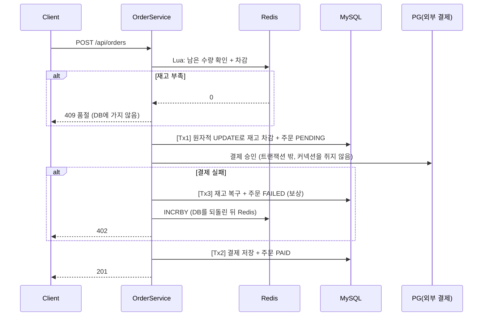

# 타임딜 주문 시스템

한정 재고 타임딜(주문 → 재고 → 결제)을 단계별로 만들면서, **K6 부하 테스트로 문제를 재현하고 → 지표로 원인을 찾고 → 대안을 비교해 고친 뒤 → 같은 조건으로 다시 측정**한 프로젝트입니다.

- 모든 단계의 원본 측정 결과는 `k6/results/`에, 원인 분석 과정(실패한 시도 포함)은 `docs/troubleshooting/`에 있습니다.
- 단계마다 `step-NN-broken`(문제 재현) / `step-NN-fixed`(해결) 태그로 전후 코드를 비교할 수 있습니다.

## 주요 결과

| 단계 | 문제 | 해결 | 전 → 후 |
|---|---|---|---|
| 01 | 트랜잭션 안의 외부 결제(PG) 호출로 커넥션 풀 고갈 | PG 호출을 트랜잭션 밖으로 분리, 실패 시 보상 트랜잭션 | p95 **38.3초 → 328ms**, 커넥션 점유 **320ms → 5ms** |
| 02 | 동시 주문 시 갱신 손실로 초과 판매 | 비관적 락 / 낙관적 락 / 원자적 UPDATE 비교 → 원자적 UPDATE | 재고 100개에 **300건 판매 → 100건** |
| 03 | Redis 분산 락을 커밋 전에 해제해 초과 판매 재발 | 락이 트랜잭션 전체를 감싸게 수정, DB 방식과 처리량 비교 | 초과 판매 해결. 다만 처리량이 원자적 UPDATE의 약 절반이라 **재고 차감에는 채택하지 않음** |
| 04 | 품절 후에도 모든 요청이 DB 행 락을 기다리며 커넥션 점유 | Redis 재고 카운터(Lua 스크립트) + 실패 시 보상 | 품절 응답 p95 **568ms → 1.49ms**, 품절 요청의 DB UPDATE **238,770 → 0** |
| 04 | 결제 실패 시 Redis와 DB 재고 불일치 | DB → Redis 순서로 되돌리기, Lua로 확인과 차감을 원자적으로 | 결제 20% 실패 시 판매 **81 → 100건** |
| 05 | 주문 100만 건에서 목록 조회 시 풀스캔 | 인덱스 비교 (진행 중) | 인덱스 없이 20 RPS에서 p95 **39.7초**, 조회 1회에 약 41만 행 읽음 |

## 기술 스택

| 구분 | 사용 기술 |
|---|---|
| 애플리케이션 | Java 21, Spring Boot 3.5, Spring Data JPA, Flyway |
| 저장소 | MySQL 8.4, Redis 7.4 |
| 부하 테스트 | K6 (arrival-rate 기반 시나리오) |
| 모니터링 | Micrometer, Prometheus, Grafana (대시보드를 코드로 관리) |
| 테스트 | JUnit 5, Testcontainers (MySQL, Redis) |
| 인프라 | Docker Compose (이미지 버전 고정, 컨테이너별 CPU와 메모리 제한) |

## 주문 흐름



- **Redis는 입구 필터, DB가 최종 장부입니다.** 차감은 Redis → DB, 복구는 DB → Redis 순서로 해서 Redis 수량이 DB보다 커지지 않게 했습니다. Redis 수량이 틀어지더라도 DB의 `UPDATE ... WHERE stock >= ?`가 초과 판매를 한 번 더 막습니다.
- 외부 결제 호출은 DB 트랜잭션 밖에 둡니다. 트랜잭션 경계는 `TransactionTemplate`으로 직접 엽니다. 같은 클래스 안에서 `@Transactional` 메서드를 호출하면 프록시를 거치지 않아 적용되지 않기 때문입니다.

## 단계별 문제 해결

### 01. 에러율 0%인데 p95 38초: 커넥션 풀 고갈 — [문서](docs/troubleshooting/001-p95-38s-but-zero-errors.md)
- **현상**: 60 RPS에서 에러는 0%인데 p95가 38.32초까지 늘어남
- **원인**: PG 호출(300ms)이 트랜잭션 안에 있어 커넥션을 320ms씩 점유. HikariCP active 10/10, 대기 190, Tomcat 스레드 200개 모두 사용
- **비교**: 풀을 30개로 늘리면 PG 300ms에서는 해결되지만, PG가 1초로 느려지면 p95 42.6초로 다시 고갈
- **해결**: PG 호출을 트랜잭션 밖으로 분리 → 커넥션 점유 5ms, 풀 10개 중 1~2개만 사용, PG 1초에서도 p95 1.02초(PG 지연 그대로)

### 02. 재고 차감 동시성 — [문서](docs/troubleshooting/002-oversold-after-faster.md)
- **현상**: 재고 100개에 300명이 동시 주문 → 300건 판매 (SELECT 후 계산해서 UPDATE하는 구조의 갱신 손실)

| 방식 | 정합성 | 인기 상품 300 RPS |
|---|---|---|
| 락 없음 | ❌ 초과 판매 | p95 315ms |
| 비관적 락 | ✅ | p95 312ms |
| 낙관적 락 | ✅ | **p95 12.27초**, 재시도 소진 실패 292건 (재시도 폭주) |
| 원자적 UPDATE | ✅ | p95 311ms |

- **선택**: 원자적 UPDATE. 한 행에 요청이 몰리는 타임딜에서는 낙관적 락의 재시도가 처리량을 무너뜨렸고, 비관적 락과는 성능 차이가 없어 쿼리 하나로 끝나는 쪽을 택함

### 03. Redis 분산 락 — [문서](docs/troubleshooting/003-redis-lock-released-before-commit.md)
- **현상**: `@Transactional` 메서드 안에서 락을 해제 → 커밋 전에 다음 요청이 이전 재고를 읽어 248~300건 판매
- **해결**: 락 획득과 해제가 트랜잭션 전체를 감싸게 변경 → 100건
- **측정**: 주문 처리량이 원자적 UPDATE(약 760~840 TPS)의 절반 수준(약 300~400 TPS)에서 막혔고, 대기 요청이 Tomcat 스레드 200개를 모두 차지해 상관없는 조회까지 p95 4.5초. 서버를 2대로 늘려도 락 키가 하나라 상한은 같았음
- **결론**: 재고 규칙이 WHERE 조건 하나로 표현되는 동안에는 원자적 UPDATE를 유지

### 04. Redis 재고 카운터 — [문서](docs/troubleshooting/004-sold-out-still-hits-db.md)
- **현상**: 1,500 → 3,000 RPS에서 품절 요청도 모두 원자적 UPDATE를 실행 → 행 락 대기 141,897회(386초), 커넥션 10/10, 품절 응답과 상관없는 조회 p95 모두 약 0.6초
- **원인 분석**: MySQL CPU는 약 60%로 여유가 있었지만, REPEATABLE READ에서는 조건에 맞지 않은 행의 락도 트랜잭션이 끝날 때까지 유지됨. 품절 요청끼리 같은 행 락을 기다리며 커넥션을 쥐고 있었음(커넥션 사용 0.8ms → 3.5ms)
- **1차 (DECR)**: 품절 요청의 DB 접근 0. 하지만 결제 실패 시 Redis 수량을 되돌리지 않아 판매 가능한 재고 19개가 남았고, Redis 값은 -101,146까지 내려감
- **2차 (DECR 후 음수면 INCR)**: 두 명령 사이에 다른 요청이 끼어들어, 재고가 남았는데 주문을 거절함 (동시성 테스트 200회 중 183회)
- **최종 (Lua + 보상)**: 확인과 차감을 Lua 스크립트 하나로 실행 → 잘못된 거절 0/200, 결제 20% 실패에서도 100건 판매, 테스트 후 DB 재고와 Redis 수량 일치를 자동 검사

| 1,500 → 3,000 RPS | 원자적 UPDATE만 | Redis Lua (최종) |
|---|---|---|
| 품절 응답 p95 | 568~644ms | **1.49ms** |
| 상관없는 조회 p95 | 560~634ms | **5.46ms** |
| 3,000 RPS 구간 처리량 | 2,766/s | **3,000/s** |
| 품절 요청의 DB UPDATE | 238,770 | **0** |
| 최대 사용 커넥션 / MySQL CPU | 10개 / 약 60% | 1개 / 약 2% |

### 05. 데이터 볼륨과 인덱스 (진행 중)
- 주문 100만 건(사용자 1만 명, 사용자당 평균 100건)을 SQL로 생성 (`make seed`)
- 인덱스 없이 "내 주문 목록"(커서 페이지네이션)을 측정: 10 RPS는 정상, **20 RPS에서 처리량이 초당 약 15건에 멈추고** 커넥션 10/10, 대기 190, p95 39.7초
- 실행 계획: `ORDER BY id DESC LIMIT 20`이라 PK를 역순으로 읽다가 20건을 찾으면 멈춤(약 36만 행, 74ms). 해당 사용자의 결과가 20건보다 적으면 100만 행을 모두 읽음(197ms)
- 다음 단계: `(user_id)` 단일, `(user_id, id)`·`(user_id, status, id)` 복합, 커버링 인덱스 비교. 이어서 PK 전략(AUTO_INCREMENT / UUID v4 / UUID v7)별 INSERT 성능 비교

## 측정 방법

- **환경 고정**: MySQL(CPU 2, 메모리 2GB), Redis(CPU 1), HikariCP 10, Tomcat 200, JVM 1GB. 환경을 바꾸면 이전 수치와 직접 비교하지 않습니다 → [측정 환경](docs/measurement-env.md)
- **부하 모델**: K6 `ramping-arrival-rate`로 목표 RPS를 단계적으로 올립니다. 응답이 느려져도 요청 속도가 줄지 않는 열린 모델이라 대기열이 드러납니다. 상관없는 API 조회를 함께 보내서 다른 요청까지 느려지는지 확인합니다.
- **정합성 검사**: 매 실행 뒤 `남은 재고 + 판매 수량 = 초기 재고`, 그리고 DB 재고와 Redis 수량이 같은지 자동으로 검사합니다.
- **원인 지표**: HikariCP active/pending, 커넥션 사용 시간, Tomcat busy 스레드는 Prometheus로 봅니다. MySQL의 실행된 SQL 수, 행 락 대기 횟수와 시간, 읽은 행 수는 테스트 전후 `SHOW GLOBAL STATUS` 차이로 결과 파일에 남깁니다.
- 같은 조건에서 결과가 뒤집히는 차이(예: 900 RPS 이상에서 비관적 락과 원자적 UPDATE의 순위)는 결론으로 쓰지 않았습니다.

## 실행

```bash
make up          # MySQL, Redis, Prometheus, Grafana
make run-perf    # 애플리케이션 (jar, 고정 JVM 옵션) → localhost:8080
make test        # 테스트 (Testcontainers)

make k6 SCRIPT=step04-soldout LABEL=fixed   # 데이터 초기화 → 부하 테스트 → 결과 저장 → 정합성 검사
make seed && make k6 SCRIPT=step05-orders LABEL=broken RESET=0   # 주문 100만 건에서 측정
```

| 주소 | 용도 |
|---|---|
| http://localhost:3000 | Grafana (`Timedeal / Timedeal App`) |
| http://localhost:9090 | Prometheus |

| API | 설명 |
|---|---|
| `POST /api/orders` | 주문 (재고 부족 409, 결제 실패 402) |
| `GET /api/orders/{id}` | 주문 조회 |
| `GET /api/users/{userId}/orders?status=&cursor=&size=` | 내 주문 목록 (커서 페이지네이션) |
| `GET /api/products/{id}` | 상품과 남은 재고 |

## 디렉토리

```
app/                    Spring Boot 애플리케이션
infra/                  docker-compose, Prometheus, Grafana 대시보드
k6/scripts/             단계별 부하 시나리오
k6/results/             원본 측정 결과 (가공하지 않음)
k6/sql/                 데이터 초기화, 시드, 정합성 검사, DB 지표 수집
docs/troubleshooting/   단계별 원인 분석 (현상 → 가설 → 검증 → 실패한 시도 → 해결 → 결과)
docs/measurement-env.md 측정 환경
```

## 연재 글

1. [재고 100개에 300명이 샀고, 응답은 38초 걸렸다 — K6 부하 테스트로 찾은 문제 3가지](https://90000e.tistory.com/20)
2. [커넥션 풀을 3배로 늘렸더니 해결됐다, PG가 느려지기 전까지는 — 트랜잭션 범위 줄이기](https://90000e.tistory.com/21)
3. [동시성 처리 — 비관적 락 vs 낙관적 락 vs 원자적 UPDATE](https://90000e.tistory.com/22)
4. [Redis 분산 락 vs 비관적 락](https://90000e.tistory.com/23)

## 다음 단계

Kafka 주문 이벤트 발행 → 아웃박스 패턴 → 멱등성(결제 중복 요청, 중복 소비) → 서비스 분리와 사가 패턴(재고 보상) → 종합 부하 테스트
