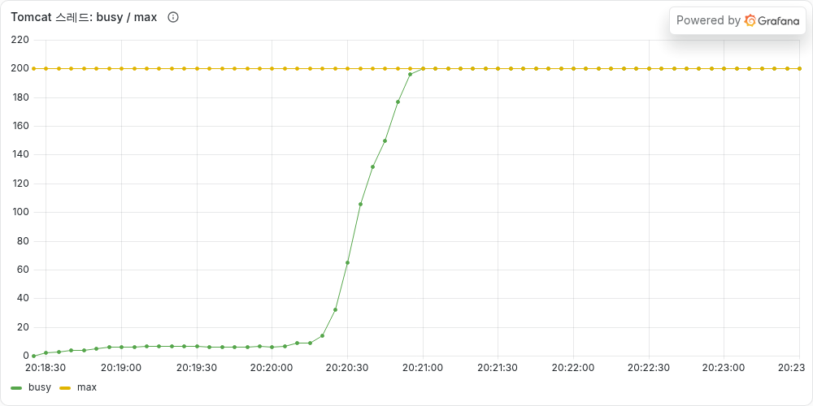
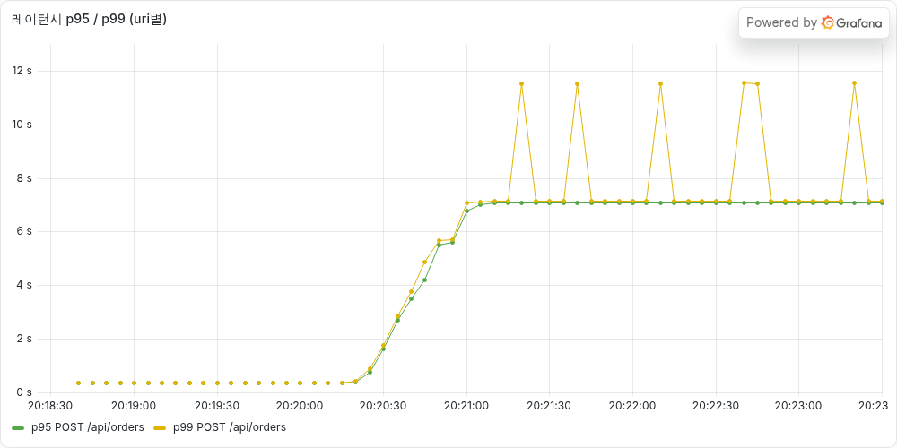

# [타임딜 #01] 재고 100개에 300명이 샀고, 응답은 38초 걸렸다 — K6 부하 테스트로 찾은 문제 3가지

> **이번 글 요약**
> 타임딜 주문 API를 만들고 K6로 부하를 걸어봤다. 에러는 하나도 없었는데, 실제로는 세 가지가 망가져 있었다.
>
> | | 문제 | 관측한 수치 |
> |---|---|---|
> | 1 | **너무 느리고, 초당 처리량이 낮다** | p95 **38초**, 최대 약 **31 TPS** |
> | 2 | **재고가 맞지 않는다** | 재고 100개에 **300명 전원 구매 성공**, 남은 재고 **70개** |
> | 3 | **사용자가 포기한 주문도 결제된다** | 응답을 못 받은 요청 **550건이 전부 결제 완료** |
>
> 이번 글에서는 고치지 않는다. **무엇이, 왜 망가졌는지**만 정리하고, 다음 글부터 하나씩 고친다.

---

## 무엇을 만들었나

타임딜 상품(재고 100개)을 오픈 시간에 많은 사람이 동시에 주문하는 상황을 가정했다. 주문 한 건의 흐름은 이렇다.

```text
POST /api/orders  (하나의 @Transactional 안에서)
  1. 재고 조회 → 재고 차감
  2. 주문 저장 (결제 대기)
  3. 외부 PG사에 결제 승인 요청  ← 응답까지 약 0.3초
  4. 결제 정보 저장, 주문 완료
```

처음부터 정답 코드를 쓰지 않고 **일부러 단순하게** 만들었다. 문제를 직접 터뜨려 봐야 왜 고쳐야 하는지 설명할 수 있기 때문이다.

- 코드: https://github.com/gamgam330/timedeal-order-system (`step-01-broken` 태그)
- 환경: Spring Boot 3.5, MySQL 8.4, HikariCP 커넥션 풀 10개, Tomcat 스레드 200개 (전부 기본값)

## 어떻게 테스트했나

두 가지 시나리오를 돌렸다.

| 시나리오 | 내용 | 확인하려는 것 |
|---|---|---|
| **처리량 테스트** | 초당 요청 수를 20 → 40 → 60으로 늘린다 | 얼마나 버티는가 |
| **타임딜 오픈** | 재고 100개 상품에 300명이 동시에 1번씩 주문 | 재고가 정확히 맞는가 |

> **먼저 알아둘 용어**
> - **RPS / TPS**: 초당 들어온 요청 수 / 초당 처리한 요청 수
> - **p95**: 응답 시간을 빠른 순으로 줄 세웠을 때 95번째. "100명 중 95명은 이 시간 안에 응답을 받았다"는 뜻이다. 평균보다 실제 체감에 가깝다.
> - **커넥션 풀**: DB 연결을 미리 만들어 두고 빌려 쓰는 곳. 여기서는 10개뿐이다.
> - **목표(SLO)**: p95 0.5초 미만, 에러율 1% 미만

---

## 문제 1. 너무 느리고, 초당 31건밖에 처리하지 못한다

### 관측 결과

| 지표 | 값 |
|---|---|
| 서버 처리량 | 20 RPS일 때 **19.9**, 40·60 RPS일 때 **31** 근처에서 멈춤 |
| 응답 시간 | 중앙값 8.7초, **p95 38.3초**, 최대 45.9초 |
| 에러율 | **0%** |


초당 40건을 넣기 시작한 순간부터 응답 시간이 계속 올라간다. 그런데 **에러는 0%** 다. 모든 요청이 결국 "성공"했다. 다만 성공 응답을 받기까지 40초 가까이 걸렸다. 실제 사용자라면 그 전에 새로고침하거나 떠났을 것이다. **에러율만 봤다면 정상이라고 착각했을 상황**이다.

### 왜 이런 일이 생겼나

**은행 창구**로 비유하면 이해가 쉽다.

| 은행 | 서버 |
|---|---|
| 창구 직원 10명 | DB 커넥션 10개 |
| 대기실 의자 200개 | Tomcat 스레드 200개 |
| 손님 한 명 응대에 0.3초 | 주문 한 건이 커넥션을 쥐고 있는 시간 |

창구가 10개이고 한 명에 0.3초씩 걸리면, 1초에 받을 수 있는 손님은 최대 **10 ÷ 0.3 ≈ 33명**이다. 그 이상 오면 줄이 생길 수밖에 없다. 실제 측정값(31 TPS)이 이 계산과 거의 같다.

그럼 왜 0.3초나 걸릴까? 주문 과정에서 **외부 PG사의 응답을 기다리는 동안에도 DB 커넥션을 계속 쥐고 있기 때문**이다. 창구 직원이 손님 대신 다른 은행에 전화를 걸어 놓고, 통화가 끝날 때까지 다음 손님을 받지 않는 셈이다.

모니터링(Grafana)을 보면 줄이 어디에 생겼는지 보인다.


- **active(쓰는 중인 커넥션)**: 10개에 꽉 찼다.
- **pending(커넥션을 기다리는 요청)**: 190에서 더 늘지 않고 멈췄다.



같은 시점에 **Tomcat 스레드도 200개가 전부 찼다.** 왜 190에서 멈췄는지가 여기서 풀린다. 스레드 200개 중 10개는 창구에서 일하고 있고, 나머지 190개가 창구 앞에서 기다린다. **대기실 의자가 다 찼으니 줄이 더 길어질 수 없다.**

그러면 의자에도 못 앉은 요청은 어디서 기다릴까? **건물 밖**이다. 서버는 요청을 받아만 두고 아직 처리를 시작하지 않은 상태다.



서버가 직접 잰 응답 시간은 **약 7초(최대 12.6초)에서 멈췄다.** 반면 K6(사용자 쪽)가 잰 시간은 **최대 40초**였다. 서버는 의자에 앉은 순간부터 시간을 재기 때문에, **건물 밖에서 기다린 약 30초는 서버 지표에 아예 보이지 않는다.** 서버 지표만 보고 있었다면 "조금 느리네" 정도로 넘어갔을 것이다.

> **정리**: 외부 결제를 기다리는 동안 DB 커넥션을 붙잡고 있어서, 커넥션 10개로는 초당 약 31건이 한계였다. 넘친 요청은 서버 지표에도 안 잡히는 곳에서 줄을 섰다.

---

## 문제 2. 재고 100개인데 300명이 샀다

### 관측 결과

재고 100개 상품에 300명이 동시에 1개씩 주문했다.

| | 기대한 결과 | 실제 결과 |
|---|---|---|
| 주문 성공 | 100명 | **300명** |
| 품절 응답 | 200명 | **0명** |
| 남은 재고 | 0개 | **70개** |

300개가 팔렸는데 재고는 30개만 줄었다. 팔 수 없는 물건 200개를 결제까지 받은 것이다. 이번에도 **에러는 하나도 없었다.**

### 왜 이런 일이 생겼나

재고를 줄이는 코드는 이렇다.

```java
public void decreaseStock(int quantity) {
    if (stock < quantity) throw new OutOfStockException(...);
    this.stock -= quantity;   // 읽은 값에서 빼서 덮어쓴다
}
```

"읽고 → 계산하고 → 덮어쓰는" 방식이다. 두 사람이 거의 동시에 주문하면 이런 일이 생긴다.

```text
시간  사용자 A                   사용자 B
 1   재고 읽음: 100
 2                              재고 읽음: 100
 3   100 - 1 = 99 저장
 4                              100 - 1 = 99 저장   ← A가 줄인 1개가 사라짐
결과  2개가 팔렸는데 재고는 99
```

B는 A가 바꾸기 **전의 값**을 보고 계산했다. 그래서 A의 변경을 덮어써 버렸다. 이것을 **갱신 손실(lost update)** 이라고 한다. 동시에 10개의 트랜잭션이 같은 재고를 읽으면 10건이 팔려도 재고는 1개만 줄어든다. 재고가 줄지 않으니 "품절" 판정도 나오지 않고, 300명 모두 성공한다.

> **정리**: 여러 요청이 같은 재고를 동시에 읽고 각자 덮어써서, 판매 기록이 사라졌다. 동시성 제어(락 등)가 전혀 없기 때문이다.

---

## 문제 3. 사용자는 포기했는데, 결제는 됐다

### 관측 결과

처리량 테스트가 끝나는 순간, K6는 아직 응답을 못 받은 요청 **550건**을 끊었다. 사용자로 치면 기다리다 지쳐서 창을 닫은 상황이다. 그런데 테스트가 끝난 뒤 DB를 확인해 보니:

| | 건수 |
|---|---|
| K6가 성공 응답을 받은 주문 | 8,034건 |
| DB에 결제 완료로 남은 주문 | **8,584건** (+550) |

**끊긴 550건이 전부 결제까지 끝나 있었다.**

### 왜 이런 일이 생겼나

사용자가 떠나도 서버는 그 사실을 모른다. 문제 1에서 본 것처럼 요청은 건물 밖 줄에서 기다리다가, 차례가 오면 끝까지 처리된다.

사용자 입장에서는 이렇게 된다.

```text
주문 버튼 클릭 → 40초 동안 응답 없음 → "실패했나?" 하고 다시 클릭
→ 결과: 주문 2건, 결제 2번
```

**중복 결제**의 씨앗이다. 서버가 "같은 주문 요청이 두 번 왔다"는 걸 알아볼 방법(멱등성)이 없기 때문이다.

> **정리**: 응답이 늦으면 사용자는 재시도한다. 그런데 서버는 이미 처리 중인 요청과 재시도를 구분하지 못한다.

---

## 그래서, 하나씩 고친다

세 문제를 원인으로 다시 묶으면 이렇다.

| 문제 | 원인 | 고칠 방향 | 다룰 글 |
|---|---|---|---|
| 1. 느리다 / TPS가 낮다 | 외부 결제를 기다리는 동안 DB 커넥션을 쥐고 있다 | 커넥션 풀을 늘리면 될까? 트랜잭션 범위를 줄여야 할까? | **#02** |
| 2. 재고가 맞지 않는다 | 동시에 읽고 덮어쓴다 (락이 없다) | 비관적 락, 낙관적 락, Redis 분산 락 비교 | 동시성 편 |
| 3. 포기한 주문도 결제된다 | 같은 요청인지 구분할 방법이 없다 | 멱등성 키 | 멱등성 편 |

고칠 때마다 **이번과 똑같은 테스트**를 다시 돌려서, 고치기 전과 후를 숫자로 비교할 것이다. 그리고 한 번에 하나씩만 고친다. 여러 개를 동시에 바꾸면 무엇 때문에 좋아졌는지 말할 수 없기 때문이다.

다음 글에서는 문제 1부터 고친다. 가장 쉬운 방법은 커넥션 풀을 10개에서 30개로 늘리는 것인데, 과연 그걸로 충분할까?

---

## AI와 함께한 부분

이 프로젝트는 Claude Code와 함께 진행하고 있다. 코드와 인프라는 AI가 쓰고, 나는 모든 결정의 이유를 듣고 고른다.

- **AI가 틀린 것**: 테스트 전에 AI는 "30초가 지나면 커넥션 타임아웃 에러가 쏟아질 것"이라고 예측했다. 실제로는 에러가 0건이었다. Tomcat 스레드 수(200)가 커넥션 대기 줄의 길이를 제한한다는 점을 놓친 것이다.
- **AI가 잘한 것**: 서버가 잰 시간(약 7초)과 사용자가 잰 시간(약 40초)의 차이를 짚어서, 서버 지표에 보이지 않는 대기 줄을 찾아냈다.
- **내가 판단한 것**: 문제가 여러 개 보여도 한 번에 고치지 않고, 먼저 전부 진단한 다음 하나씩 고치기로 했다.

예측을 먼저 적어 두고 데이터로 확인해 보니, AI의 예측도 결국 검증해야 할 가설 중 하나였다.
