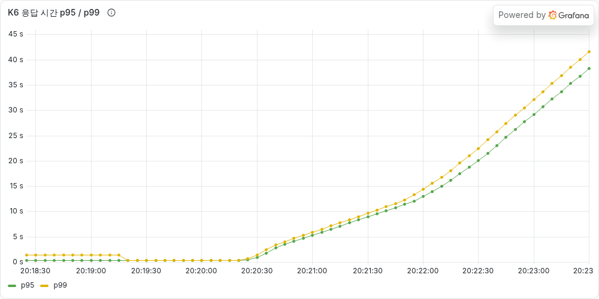
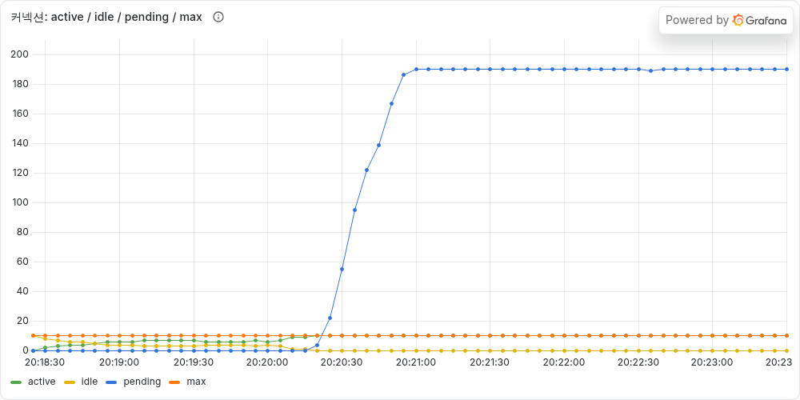
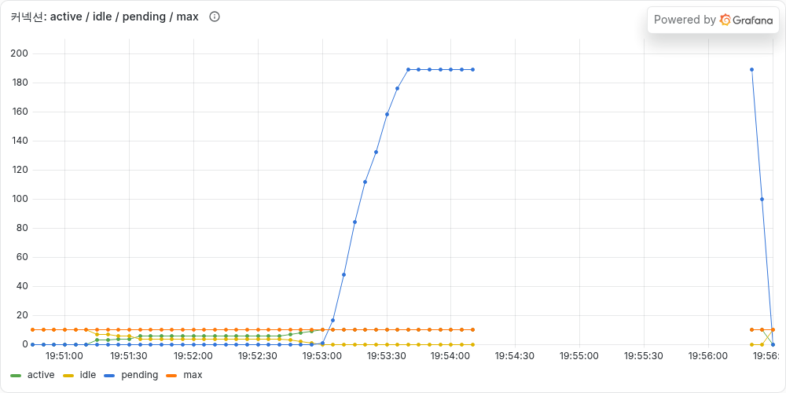
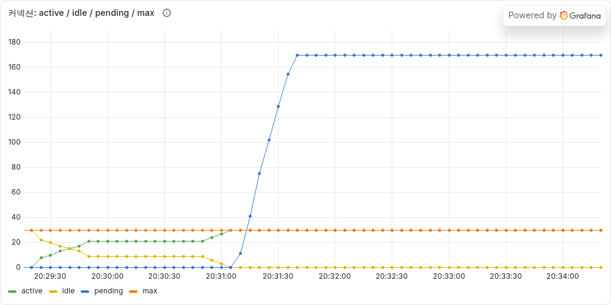
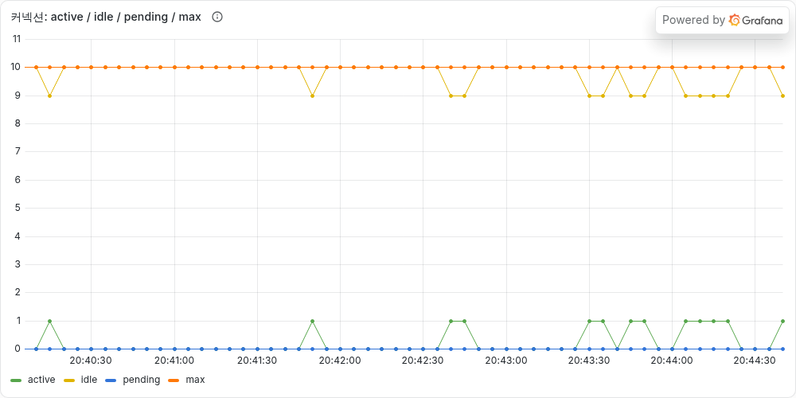

# [타임딜 #01] 에러율 0%인데 p95가 38초였다 — HikariCP 커넥션 풀 고갈과 트랜잭션 밖으로 PG 빼기

> **TL;DR**
> - 주문 API에 K6로 20 → 40 → 60 RPS를 걸었더니 **에러는 0%인데 p95가 38초**였다.
> - 원인은 트랜잭션 안의 외부 PG 호출(300ms). 커넥션 10개가 PG를 기다리느라 **최대 약 33 TPS**에서 막혔고, 나머지 요청은 서버 지표에도 안 잡히는 Tomcat 앞단에서 줄을 섰다.
> - 풀을 30으로 늘리면 통과는 하지만 PG가 1초로 느려지자 다시 42초. **PG 호출을 트랜잭션 밖으로 빼서** 커넥션 점유 시간을 320ms → 5ms로 줄였고, 풀 10개 그대로 60 RPS를 p95 328ms로 통과했다.
>
> | | 풀 | PG 지연 | p95 |
> |---|---|---|---|
> | 처음 | 10 | 300ms | **38.3s** |
> | 풀 늘리기 | 30 | 1s | **42.6s** |
> | 트랜잭션 분리 | 10 | 300ms / 1s | **328ms / 1.02s** |
>
> 코드: [step-01-broken → step-01-fixed 비교](https://github.com/gamgam330/timedeal-order-system/compare/step-01-broken...step-01-fixed)

---

## 오늘의 상황

타임딜 주문 시스템을 만들고 있다. 재고 100개짜리 키보드를 오픈 시간에 수백 명이 동시에 사는 상황이다. 흐름은 단순하다.

```
POST /api/orders
 └ @Transactional placeOrder()
    1. 재고 조회 → 차감
    2. 주문 저장 (PENDING)
    3. PG 결제 승인 요청 (가짜 PG, 300ms)
    4. 결제 저장, 주문 PAID
```

일부러 순진하게 짰다. 처음부터 정답 코드를 쓰면 무엇이 왜 문제인지 설명할 수가 없어서, **먼저 터뜨리고 고치는 방식**으로 가기로 했다.

부하 테스트 전에 계산부터 해봤다. 커넥션 하나가 요청 하나를 처리하는 데 약 0.3초가 걸리니 초당 3.3건, 풀이 10개니까 **약 33 TPS가 한계**일 것이다. 그리고 예측을 하나 적어뒀다.

> "40 RPS부터 Hikari 대기가 쌓이고, 30초(connectionTimeout)가 지나면 `SQLTransientConnectionException`이 쏟아질 것이다."

**이 예측은 틀렸다.**

## 측정 환경

- K6 `ramping-arrival-rate`: 20 → 40 → 60 RPS, 단계마다 1분씩 유지
  - VU를 고정하는 방식(닫힌 모델)은 서버가 느려지면 VU가 응답을 기다리느라 **요청을 덜 보낸다.** 부하가 저절로 줄어서 지연이 실제보다 작게 보인다(coordinated omission). 실제 사용자는 서버가 느리다고 덜 오지 않으니, 초당 요청 수를 고정하는 열린 모델을 썼다.
- SLO: p95 < 500ms, 에러율 < 1%
- 앱: Spring Boot 3.5, Tomcat 스레드 200(기본값), HikariCP 풀 10(기본값)
- MySQL 8.4 (CPU 2, 메모리 2GB 제한), Prometheus + Grafana로 서버 지표 수집
- K6 결과도 Prometheus로 보내서 **클라이언트가 본 지연과 서버 지표를 한 화면에** 놓았다

## 첫 번째 결과: 에러는 없는데 사용자는 40초를 기다린다

| 지표 | 값 |
|---|---|
| 서버 처리량 | 20 RPS 구간 19.8 / 40 RPS 구간 **33.0** |
| K6 응답 시간 | 중앙값 8.5초, **p95 38.3초**, 최대 45.9초 |
| 에러율 | **0%** |



처리량은 계산대로 33에서 막혔다. 그런데 **에러가 하나도 없다.** 30초 넘게 기다린 요청이 있는데 커넥션 타임아웃은 왜 안 났을까?

## 삽질 기록

### 가설 1: Hikari 대기가 30초를 넘겼을 것이다 → 기각

Grafana를 열어봤다.



- Hikari 타임아웃: **0건**
- 커넥션을 기다리는 스레드(pending): **190에서 딱 멈춤**
- 커넥션 획득 대기 최대: **12.3초** (30초에 한참 못 미침)

Hikari 앞의 줄은 190에서 더 길어지지 않았다. 왜 하필 190일까?

### 가설 2: 줄이 한 겹이 아니다

Tomcat 스레드를 봤더니 **200 / 200**이었다. 그제야 그림이 그려졌다.

```
요청 → [① Tomcat 대기열]          → [② Hikari 대기열]      → DB + PG(300ms)
       워커 스레드 200개를 기다림      커넥션 10개를 기다림
       서버 지표에 안 잡힘             최대 190개, 최대 12초
```

- 스레드 200개 중 10개는 커넥션을 잡고 일하고, 나머지 190개가 Hikari 앞에서 기다린다. **스레드 수가 Hikari 줄의 길이를 제한한다.** 그래서 Hikari 대기는 30초까지 가지 못했다.
- 나머지 요청은 **워커 스레드를 받기도 전에** 기다린다. 서버의 응답 시간 타이머는 스레드가 요청을 집은 뒤부터 재기 때문에, 이 시간은 서버 지표에 보이지 않는다.
- 실제로 서버가 잰 최대 응답 시간은 12.5초였고, K6가 본 p99는 41초였다. **이 29초 차이가 보이지 않는 대기열이다.**

에러율만 봤다면 정상이라고 판단했을 것이다. HTTP 201을 받기까지 40초가 걸리는 서비스를 정상이라고 할 수는 없다.

### 덤으로 터진 것: 모니터링이 가장 중요한 2분 동안 꺼졌다



그래프 중간이 비어 있다. Prometheus가 지표를 가져가는 `/actuator/prometheus`도 **주문 요청과 같은 Tomcat 대기열에 줄을 섰고**, 5초 수집 제한에 걸려 실패했다. 장애 상황을 보려고 만든 모니터링이 정작 장애 순간에 눈을 감았다.

→ `management.server.port: 8081`로 관리 포트를 분리했다. 별도 Tomcat 커넥터와 스레드 풀을 쓰기 때문에, 이후 측정에서는 한 번도 끊기지 않았다.

### 실패한 시도 1: 측정이 오염됐다

해결책을 시험하다가 실패 38건, 최대 응답 1분 39초라는 이상한 결과가 나왔다. 앱 로그에 이런 경고가 있었다.

```
HikariPool-1 - Thread starvation or clock leap detected (housekeeper delta=2m6s234ms)
```

30초마다 도는 Hikari 관리 스레드가 2분 6초 만에 깼다는 건, 프로세스 자체가 멈췄다는 뜻이다. `pmset -g log`를 봤더니 테스트 도중 **맥북이 잠자기에 들어갔다**(배터리 모드, Idle Sleep 99초). 결과를 버리고 `caffeinate`로 감싸서 다시 쟀다. 결과가 이상하면 코드보다 측정 환경부터 의심해야 한다.

### 실패한 시도 2: 풀을 30으로 늘렸다

가장 쉬운 방법부터 해봤다. 리틀의 법칙(L = λ × W)으로 계산하면 60 TPS × 0.31초 = 약 19개가 필요하다.

| 풀 | PG 지연 | p95 | 동시에 쓴 커넥션 최대 |
|---|---|---|---|
| 30 | 300ms | **325ms ✓** | **19** |

통과했다. 동시에 쓴 커넥션 최대값이 계산값(18.7)과 정확히 맞았다. 여기서 끝내고 싶었지만, **PG가 느려지면?** 외부 시스템이 느려지는 건 흔한 장애다. PG 지연을 1초로 바꿔봤다.

| 풀 | PG 지연 | p95 |
|---|---|---|
| 30 | **1초** | **42.6초 ✗** |



다시 무너졌다. 처리 한계는 `풀 크기 ÷ PG 지연`에 묶여 있다. PG가 3배 느려지면 풀도 3배가 필요하다. 그리고 풀을 무한정 늘릴 수도 없다. DB 쪽 스레드와 메모리, 락 경합이 같이 늘어나고, 인스턴스를 여러 대 띄우면 `max_connections`에 걸린다. **풀을 늘리는 건 문제를 미루는 것**이었다.

## 해결: PG 호출을 트랜잭션 밖으로

진짜 문제는 **커넥션을 쥔 채로 외부 응답을 기다리는 구조**였다.

```
[트랜잭션1] 재고 예약 + 주문 PENDING → 커밋 (커넥션 반납)
PG 승인 요청                         ← 커넥션 없이 기다림
  성공 → [트랜잭션2] 결제 저장 + 주문 PAID
  실패 → [트랜잭션3] 재고 복구 + 주문 FAILED
```

```java
public Order placeOrder(Long userId, Long productId, int quantity) {
    Order order = transactionTemplate.execute(status -> {
        Product product = productService.decreaseStock(productId, quantity);
        return orderRepository.save(Order.create(userId, productId, quantity, product.getPrice()));
    });

    String pgTransactionId;
    try {
        pgTransactionId = paymentService.requestApproval(order.getId(), order.getTotalPrice());
    } catch (PaymentFailedException e) {
        transactionTemplate.executeWithoutResult(status -> {
            productService.increaseStock(productId, quantity);   // 보상
            findOrder(order.getId()).markFailed();
        });
        throw e;
    }

    return transactionTemplate.execute(status -> {
        paymentService.saveApproved(order.getId(), order.getTotalPrice(), pgTransactionId);
        Order paid = findOrder(order.getId());
        paid.markPaid();
        return paid;
    });
}
```

고민했던 점 두 가지:

1. **왜 `@Transactional` 메서드 세 개가 아니라 `TransactionTemplate`인가?** 같은 클래스 안에서 `this.reserve()`처럼 부르면 프록시를 거치지 않아서 `@Transactional`이 적용되지 않는다(self-invocation). 클래스를 쪼개는 방법도 있지만, 트랜잭션 경계 세 개가 한 메서드에 보이는 쪽이 의도를 더 잘 드러낸다고 판단했다.
2. **결제가 실패하면 왜 롤백이 아니라 "재고 복구"인가?** 트랜잭션1은 이미 커밋됐다. 커밋된 것은 롤백할 수 없고, 반대 작업으로 **보상**해야 한다. 이 차이는 나중에 사가 패턴에서 다시 나온다.

**새로 생긴 위험도 적어둔다.** PG 승인은 성공했는데 트랜잭션2가 실패하거나 그 사이에 서버가 죽으면, 돈은 빠져나갔는데 주문은 PENDING으로 남는다. 이건 멱등성과 사가 편에서 다룬다.

## 결과

같은 날, 같은 환경에서 연속으로 측정했다.

| 실행 | 풀 | PG 지연 | K6 p95 | Hikari pending | 커넥션 점유 시간 | SLO |
|---|---|---|---|---|---|---|
| 처음 | 10 | 300ms | 38.3s | 190 | 320ms | ✗ |
| 풀 늘리기 | 30 | 300ms | 325ms | 0 | 312ms | ✓ |
| 풀 늘리기 | 30 | 1s | 42.6s | 170 | 1018ms | ✗ |
| **트랜잭션 분리** | **10** | 300ms | **328ms** | 0 | **5ms** | ✓ |
| **트랜잭션 분리** | **10** | 1s | **1.02s** | 0 | **5ms** | PG 자체가 1초 |



- 커넥션 점유 시간이 **320ms → 5ms (64배)**. 60 RPS에서도 커넥션을 1~2개만 쓴다.
- PG가 1초로 느려져도 대기열이 쌓이지 않는다. 지연은 PG만큼 늘었지만 **일정하다**. 풀을 늘렸을 때는 42초까지 계속 증가했다.

### 그런데 아직 끝나지 않았다

1. **다음 병목은 스레드다.** PG 1초일 때 Tomcat busy 스레드가 61개였다(60 RPS × 1초). 이제는 커넥션 대신 스레드가 PG를 기다린다.
2. **사실 처음부터 데이터가 깨지고 있었다.** 재고 100개 상품에 300명이 동시에 주문했더니 **300명 전원이 성공했고 재고는 70개가 남았다.** 에러는 하나도 없었다. 트랜잭션을 짧게 만든 뒤로 재고 손실은 7115건에서 24건으로 줄었지만, 줄어든 것이지 고쳐진 게 아니다. 드물어진 버그는 더 찾기 어렵다. 이건 동시성 편에서 고친다.
3. **클라이언트가 포기한 요청도 서버는 끝까지 처리했다.** K6가 끊은 550건이 나중에 전부 결제 완료가 됐다. 사용자는 실패한 줄 알고 다시 누를 것이다. 중복 결제의 씨앗이다.

## AI와 함께한 부분

이 프로젝트는 Claude Code와 같이 진행하고 있다. 코드와 인프라는 AI가 쓰고, 나는 모든 결정의 이유를 듣고 고르는 역할이다.

- **AI가 잘한 것**
  - 서버 지표와 클라이언트 지표의 29초 차이에서 "보이지 않는 대기열"을 찾아냈다.
  - 이상한 측정 결과를 앱 버그로 몰지 않고 로그 한 줄(`clock leap`)에서 맥 잠자기를 추적했다.
  - 풀 늘리기가 정답처럼 보이지 않도록 PG 지연 시나리오를 먼저 제안했다.
- **AI가 틀린 것**
  - "30초 뒤 타임아웃 에러가 쏟아진다"는 첫 예측. Tomcat 스레드 수가 Hikari 대기열의 길이를 제한한다는 점을 놓쳤다.
- **내가 판단한 것**
  - 해결 순서: 관리 포트 분리 → 풀 늘리기(실패한 시도로 남기기) → 트랜잭션 분리
  - 갱신 손실은 눈에 띄어도 이번에는 고치지 않고 다음 단계로 넘기기(한 번에 하나만 바꿔야 무엇이 효과였는지 말할 수 있다)

AI의 예측도 검증 대상이었다. 예측을 먼저 적고 데이터로 확인하는 습관이 이번 글에서 가장 크게 배운 점이다.

---

- 코드: https://github.com/gamgam330/timedeal-order-system
- 이번 변경: [step-01-broken → step-01-fixed](https://github.com/gamgam330/timedeal-order-system/compare/step-01-broken...step-01-fixed)
- 다음 편: 인덱스 없는 100만 건 주문 테이블에서 "내 주문 목록" 조회하기
