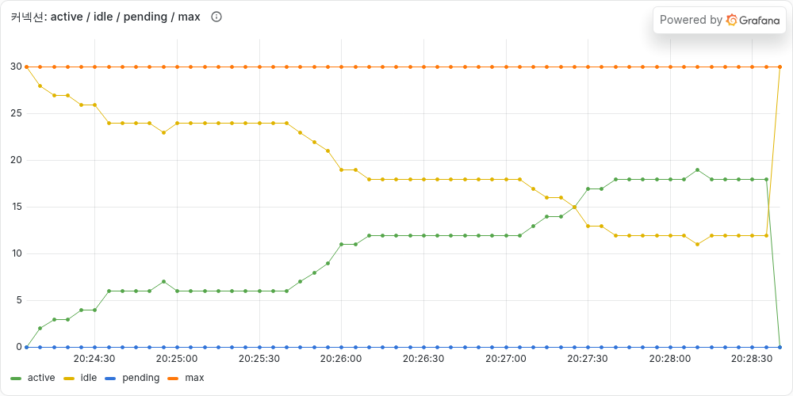
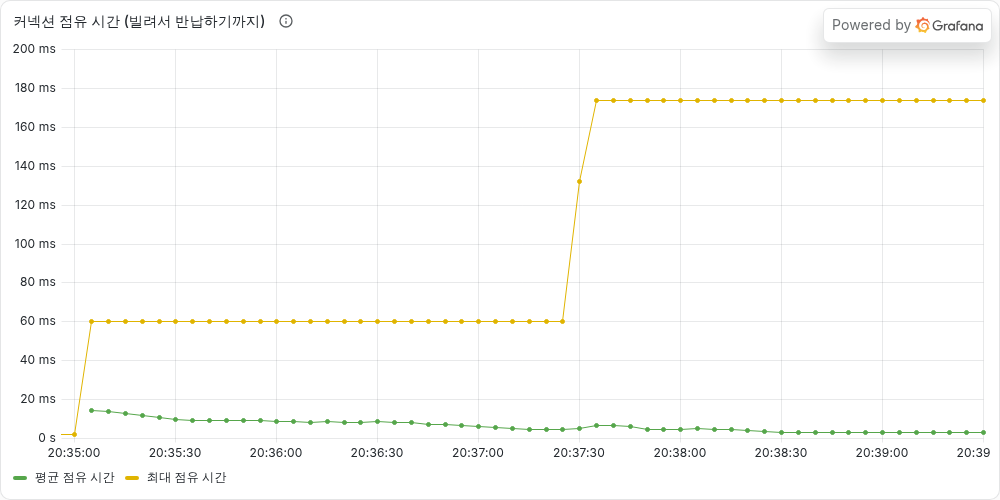
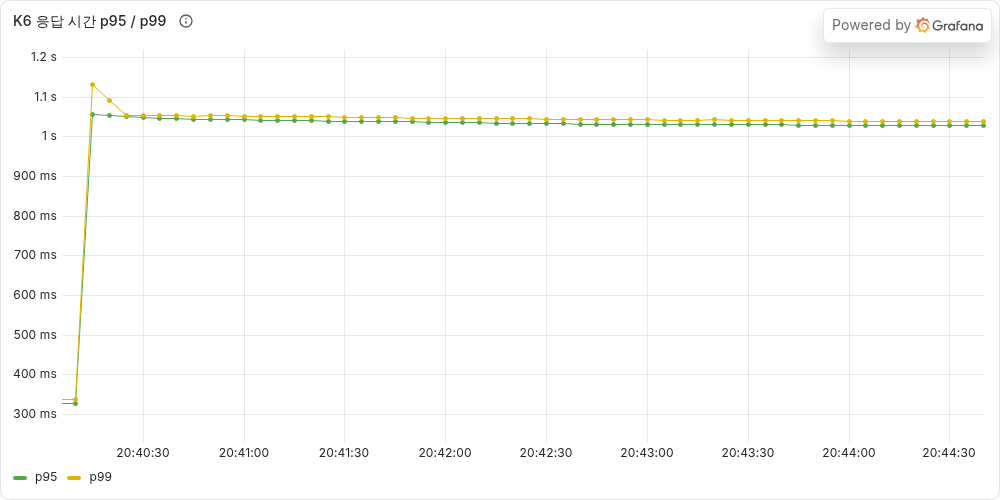

# [타임딜 #02] 커넥션 풀을 3배로 늘렸더니 해결됐다, PG가 느려지기 전까지는 — 트랜잭션 범위 줄이기

> **이번 글 요약**
> [지난 글](https://90000e.tistory.com/20)에서 찾은 **문제 1(너무 느리고, 초당 31건밖에 처리 못 함)** 을 고친다.
>
> | 시도 | 결과 |
> |---|---|
> | 커넥션 풀 10개 → 30개 | 통과했다. 그런데 **PG가 1초로 느려지자 p95 42초**로 다시 무너졌다 |
> | 외부 결제 호출을 트랜잭션 밖으로 | **풀 10개 그대로** p95 38초 → **0.33초**. PG가 1초로 느려져도 버틴다 |
>
> 핵심은 하나다. **커넥션을 늘리는 것보다, 커넥션을 쥐고 있는 시간을 줄이는 게 먼저다.**

---

## 지난 글 요약: 문제 1

주문 한 건을 처리하는 동안, 외부 PG사의 결제 응답(약 0.3초)을 기다리면서도 **DB 커넥션을 계속 쥐고 있었다.**

```text
@Transactional  ← 여기서 커넥션을 빌림
  재고 차감
  주문 저장
  PG 결제 요청 ... 0.3초 대기 ...   ← 커넥션을 쥔 채로 기다림
  결제 저장
                ← 여기서 커넥션 반납
```

은행으로 치면 **창구 직원 10명이 손님마다 다른 은행에 전화를 걸고, 통화가 끝날 때까지 다음 손님을 받지 않는** 상황이었다. 그래서 1초에 최대 10 ÷ 0.3 ≈ 33명밖에 못 받았다.

고치는 방법은 두 가지가 떠오른다.

1. **창구 직원을 늘린다** → 커넥션 풀 크기를 늘린다
2. **전화하는 동안 창구를 비워 준다** → 외부 호출 중에는 커넥션을 쥐고 있지 않는다

쉬운 것부터 해봤다.

> **이번 글의 테스트**
> 지난 글과 **똑같은 테스트**(초당 20 → 40 → 60건)를 돌린다. 목표는 p95 0.5초 미만, 에러율 1% 미만.

---

## 시도 1. 커넥션 풀을 10개에서 30개로

설정 한 줄이면 된다.

```yaml
spring.datasource.hikari.maximum-pool-size: 30
```

### 몇 개면 충분할까?

감으로 정하지 않고 계산해 봤다. **필요한 커넥션 수 = 초당 요청 수 × 커넥션 하나를 쥐고 있는 시간** 이다. (이걸 **리틀의 법칙**이라고 한다.)

```text
초당 60건 × 0.31초 = 약 19개 필요  → 30개면 충분하다
```

### 결과: 통과

| 풀 | PG 응답 시간 | p95 | 에러율 | 목표 |
|---|---|---|---|---|
| 10 (지난 글) | 0.3초 | 38.3초 | 0% | ✗ |
| **30** | 0.3초 | **0.32초** | 0% | **✓** |



초록색 선(실제로 쓰는 커넥션)을 보면 **6개 → 12개 → 18개**로 계단처럼 올라간다. 초당 요청이 20 → 40 → 60건으로 늘어난 것과 정확히 맞는다(20×0.31=6, 40×0.31=12, 60×0.31=19). 계산이 그대로 맞아떨어졌다.

여기서 끝내도 될까? 한 가지가 마음에 걸렸다.

### 그런데 PG가 느려지면?

외부 시스템은 내가 통제할 수 없다. 결제사가 점검 중이거나 트래픽이 몰리면 응답이 느려지는 일은 흔하다. **PG 응답이 0.3초에서 1초로 느려진 상황**을 만들어서 같은 테스트를 돌렸다.

| 풀 | PG 응답 시간 | p95 | 목표 |
|---|---|---|---|
| 30 | 0.3초 | 0.32초 | ✓ |
| 30 | **1초** | **42.6초** | **✗** |


다시 무너졌다. 커넥션 30개가 전부 차고, 기다리는 요청(파란 선)이 170까지 쌓였다.

계산해 보면 당연하다. 커넥션 하나를 1초씩 쥐고 있으니 30개로는 **1초에 30건**이 한계다. 초당 60건을 받으려면 60개가 필요하다. PG가 2초로 느려지면 120개가 필요하다.

> **정리**: 풀을 늘리는 건 **문제를 미루는 것**이다. 처리 한계가 `풀 크기 ÷ PG 응답 시간`에 묶여 있어서, 외부 시스템이 느려지는 만큼 계속 늘려야 한다. 그리고 풀을 무한정 늘릴 수도 없다. DB가 감당할 수 있는 연결 수에도 한계가 있고, 서버를 여러 대 띄우면 그만큼 곱해진다.

---

## 시도 2. 외부 결제 호출을 트랜잭션 밖으로

진짜 문제는 **커넥션을 쥔 채로 외부 응답을 기다리는 구조**였다. 그래서 트랜잭션을 셋으로 나눴다.

```text
[트랜잭션 1] 재고 차감 + 주문 저장(결제 대기) → 커밋, 커넥션 반납
PG 결제 요청 ... 0.3초 대기 ...                ← 커넥션 없이 기다림
  성공하면 → [트랜잭션 2] 결제 저장 + 주문 완료
  실패하면 → [트랜잭션 3] 재고 되돌리기 + 주문 실패 처리
```

은행으로 치면 **직원이 전화를 걸어 두고 그동안 다음 손님을 받는** 방식이다. 통화가 끝나면 그때 다시 창구로 와서 마무리한다.

### 코드

```java
public Order placeOrder(Long userId, Long productId, int quantity) {
    // [트랜잭션 1] 재고 차감 + 주문 저장
    Order order = transactionTemplate.execute(status -> {
        Product product = productService.decreaseStock(productId, quantity);
        return orderRepository.save(Order.create(userId, productId, quantity, product.getPrice()));
    });

    // 트랜잭션 밖: 커넥션을 쥐지 않고 PG 응답을 기다린다
    String pgTransactionId;
    try {
        pgTransactionId = paymentService.requestApproval(order.getId(), order.getTotalPrice());
    } catch (PaymentFailedException e) {
        // [트랜잭션 3] 결제 실패 → 재고를 되돌린다
        transactionTemplate.executeWithoutResult(status -> {
            productService.increaseStock(productId, quantity);
            findOrder(order.getId()).markFailed();
        });
        throw e;
    }

    // [트랜잭션 2] 결제 저장 + 주문 완료
    return transactionTemplate.execute(status -> {
        paymentService.saveApproved(order.getId(), order.getTotalPrice(), pgTransactionId);
        Order paid = findOrder(order.getId());
        paid.markPaid();
        return paid;
    });
}
```

### 고민했던 점 1. 왜 `@Transactional`이 아니라 `TransactionTemplate`인가?

처음에는 같은 클래스 안에 `@Transactional` 메서드 3개를 만들어서 부르려고 했다. 그런데 **같은 클래스 안에서 `this.메서드()`로 부르면 `@Transactional`이 동작하지 않는다.**

스프링의 `@Transactional`은 **프록시**라는 대리인이 메서드 호출을 가로채서 트랜잭션을 열고 닫는 방식이다. 바깥에서 부르면 대리인을 거치지만, 클래스 안에서 자기 메서드를 부르면 대리인을 건너뛴다(self-invocation 문제).

클래스를 따로 나누는 방법도 있지만, **트랜잭션 경계 3개가 한 메서드에 보이는 쪽**이 이해하기 쉽다고 판단해서 `TransactionTemplate`으로 직접 열었다.

### 고민했던 점 2. 결제가 실패하면 왜 "롤백"이 아니라 "재고 되돌리기"인가?

예전 코드는 전부 트랜잭션 하나였다. 결제가 실패하면 예외가 나면서 재고 차감까지 **롤백**됐다.

지금은 트랜잭션 1이 **이미 커밋된 상태**다. 커밋된 것은 롤백할 수 없다. 그래서 "재고를 다시 1 늘린다"는 **반대 작업을 새로 실행**해야 한다. 이걸 **보상(compensation)** 이라고 한다.

| | 롤백 | 보상 |
|---|---|---|
| 언제 | 커밋 전 | 커밋 후 |
| 방법 | 없던 일로 만든다 | 반대 작업을 새로 실행한다 |
| 중간 상태 | 아무도 못 본다 | 잠깐 다른 사람에게 보일 수 있다 |

결제 실패 시 재고가 제대로 돌아오는지는 테스트로 확인했다.

```java
@Test
void 결제가_실패하면_재고가_복구되고_주문은_FAILED로_남는다() {
    int before = productService.getProduct(1L).getStock();

    assertThatThrownBy(() -> orderService.placeOrder(1L, 1L, 3))
            .isInstanceOf(PaymentFailedException.class);

    assertThat(productService.getProduct(1L).getStock()).isEqualTo(before);
    // 주문은 FAILED로 남고, 결제 기록은 없다
}
```

### 새로 생긴 위험

공짜는 없다. 트랜잭션을 나누면서 새로운 틈이 생겼다.

```text
PG 결제 성공 → (이 순간 서버가 죽거나 DB가 실패) → 트랜잭션 2 실행 못 함
결과: 돈은 빠져나갔는데, 주문은 "결제 대기"로 남는다
```

예전에는 "전부 성공 아니면 전부 실패"였는데, 이제는 **중간에 멈출 수 있다.** 이 문제는 멱등성과 사가 패턴 편에서 다룬다. 지금은 이런 위험이 있다는 것을 알고 넘어간다.

---

## 결과

모두 같은 날, 같은 환경에서 연속으로 측정했다.

| | 풀 | PG 응답 | p95 | 기다린 요청 최대 | 커넥션 점유 시간 | 목표 |
|---|---|---|---|---|---|---|
| 처음 | 10 | 0.3초 | 38.3초 | 190 | 0.32초 | ✗ |
| 풀 늘리기 | 30 | 0.3초 | 0.32초 | 0 | 0.31초 | ✓ |
| 풀 늘리기 | 30 | 1초 | 42.6초 | 170 | 1.02초 | ✗ |
| **트랜잭션 분리** | **10** | 0.3초 | **0.33초** | 0 | **0.005초** | **✓** |
| **트랜잭션 분리** | **10** | 1초 | **1.02초** | 0 | **0.005초** | PG 자체가 1초 |

### 커넥션 점유 시간: 0.32초 → 0.005초



커넥션 하나를 쥐고 있는 시간이 평균 **5ms 안팎**으로 줄었다. 예전(320ms)보다 **약 64배 짧다.** 같은 커넥션 10개로 이론상 초당 2,000건까지 받을 수 있다.

### PG가 1초로 느려져도


초당 60건이 들어와도 **커넥션을 1개 이하로만 쓴다.** 기다리는 요청(파란 선)은 0이다.



응답 시간은 PG가 느려진 만큼(약 1초) 늘었지만, **처음부터 끝까지 평평하다.** 풀을 늘렸을 때는 같은 상황에서 42초까지 계속 올라갔다. 줄이 쌓이지 않는다는 뜻이다.

> **정리**: 커넥션을 쥐고 있는 시간을 줄이자, 풀을 늘리지 않고도 문제가 사라졌다. 외부 시스템이 느려져도 DB 커넥션이 함께 막히지 않는다.

---

## 아직 끝나지 않은 것

1. **다음 병목은 스레드다.** PG가 1초일 때 Tomcat 스레드를 61개 쓰고 있었다(초당 60건 × 1초). 이제는 커넥션 대신 **스레드가 PG를 기다린다.** 스레드는 200개이니 PG 1초 기준으로 초당 약 200건이 다음 한계다.
2. **재고 문제는 여전하다.** 재미있게도 이번 수정 후 재고 손실이 7,115건에서 **24건**으로 줄었다. 트랜잭션이 짧아져서 "같은 재고를 동시에 읽는 시간"이 줄었기 때문이다. 하지만 **줄었을 뿐 고쳐진 게 아니다.** 오히려 드물게 일어나는 버그는 찾기 더 어렵다. 다음 단계에서 제대로 고친다.

---

## AI와 함께한 부분

- **AI가 제안한 것**: 풀을 30으로 늘리면 0.3초 환경에서는 통과할 것이라고 먼저 예측했다. 그래서 "통과했으니 끝"이 되지 않도록 **PG가 1초로 느려지는 상황**을 같이 테스트하자고 했다. 이 테스트가 없었다면 풀 늘리기를 정답으로 착각했을 것이다.
- **내가 판단한 것**: 풀 늘리기를 바로 버리지 않고, "실패한 시도"로 측정해서 남기기로 했다. 왜 트랜잭션을 나눠야 하는지 숫자로 보여줄 수 있기 때문이다.

---

- 코드: https://github.com/gamgam330/timedeal-order-system
- 이번 변경: [step-01-broken → step-01-fixed](https://github.com/gamgam330/timedeal-order-system/compare/step-01-broken...step-01-fixed)
- 지난 글: [#01 재고 100개에 300명이 샀고, 응답은 38초 걸렸다](https://90000e.tistory.com/20)
