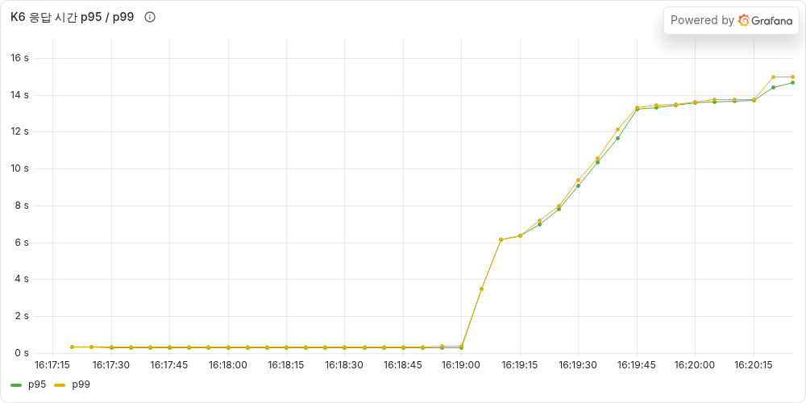
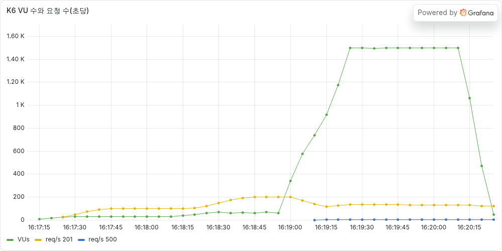
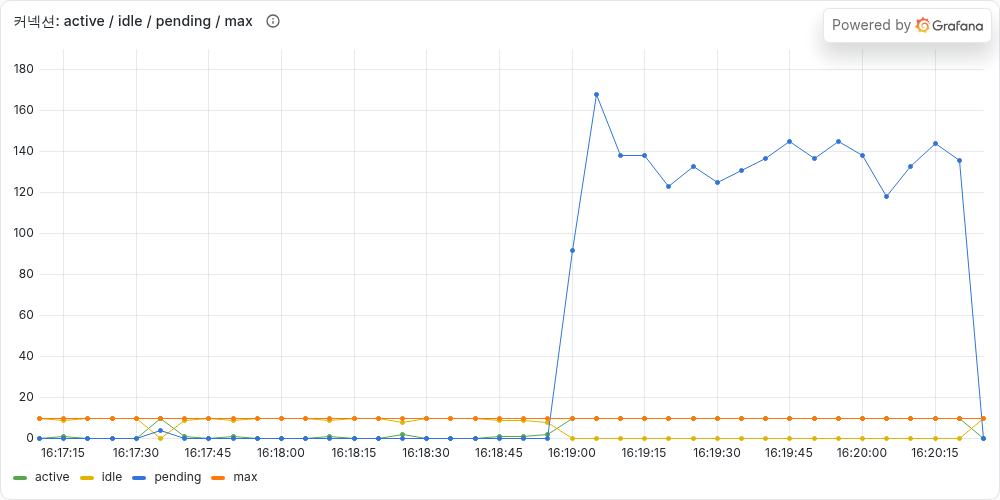
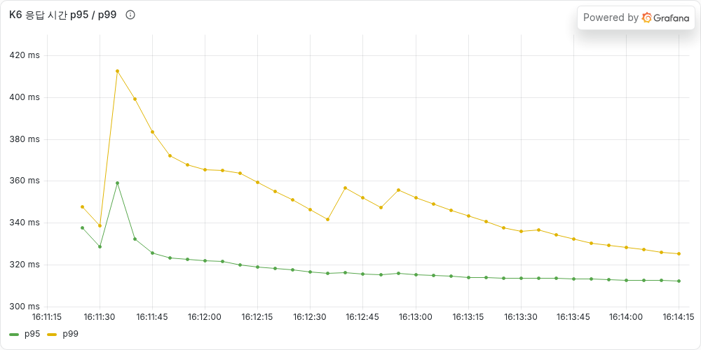

# [타임딜 #03] 빨라졌는데 여전히 300명이 샀다 — 비관적 락 vs 낙관적 락 vs 원자적 UPDATE

> **이번 글 요약**
> [진단편](https://90000e.tistory.com/20)에서 찾은 **문제 2(재고 100개에 300명이 삼)** 를 고친다.
>
> | 방식 | 재고 100개, 300명 | 인기 상품 초당 300건 |
> |---|---|---|
> | 락 없음 | **300명 성공**, 재고 65 남음 ❌ | p95 0.32초, 판매 기록 **1,105건 사라짐** ❌ |
> | 비관적 락 | 100명 성공, 재고 0 ✅ | p95 0.31초 ✅ |
> | 낙관적 락 | 100명 성공, 재고 0 ✅ | **p95 12.3초**, 실패 292건 ❌ |
> | 원자적 UPDATE | 100명 성공, 재고 0 ✅ | p95 0.31초 ✅ |
>
> 셋 다 재고는 맞췄다. 차이는 **요청이 한 상품에 몰릴 때** 났다.

---

## 고친 줄 알았다

[지난 글(#02)](https://90000e.tistory.com/21)에서 외부 결제 호출을 트랜잭션 밖으로 빼서 응답 시간을 38초에서 0.3초로 줄였다. 그때 재고 손실도 7,115건에서 24건으로 줄어서, 솔직히 "이 정도면 거의 된 거 아닌가?" 싶었다.

그래서 진단편의 **타임딜 오픈 테스트**(재고 100개 상품에 300명이 동시에 1번씩 주문)를 다시 돌려봤다.

| 회차 | 주문 성공 | 품절 응답 | 남은 재고 | p95 |
|---|---|---|---|---|
| 진단편 (고치기 전) | 300 | 0 | 70 | 9.3초 |
| 1회 | **300** | 0 | **64** | 1.1초 |
| 2회 | **300** | 0 | **65** | 0.9초 |
| 3회 | **300** | 0 | **65** | 0.8초 |

응답은 10배 빨라졌는데, **300명이 다 샀다.** 하나도 안 나아졌다. 24건이라는 숫자는 재고가 넉넉한 상품에서 천천히 들어오는 요청으로 잰 값이었다. 300명이 한꺼번에 몰리는 상황에서는 전혀 다른 얘기였다.

빨라진 것과 맞는 것은 다른 문제였다.

---

## 왜 아직도 300명이 살 수 있을까

재고를 줄이는 코드는 진단편 그대로다.

```java
Product product = productRepository.findById(productId);   // 1. 읽고
product.decreaseStock(quantity);                            // 2. 계산하고 (stock = stock - 1)
// 커밋할 때 Hibernate가 UPDATE product SET stock = 99 ... 를 실행  // 3. 덮어쓴다
```

여기서 3번이 핵심이었다. DB에 가는 건 "1 빼줘"가 아니라 **"99로 바꿔줘"** 다. 두 명이 동시에 100을 읽으면 둘 다 "99로 바꿔줘"를 보내고, DB는 시키는 대로 99를 두 번 쓴다. 하나가 사라진다. 이게 **갱신 손실(lost update)** 이다.

숫자를 다시 보니 재밌는 게 보였다. 300건이 팔렸는데 재고는 35개만 줄었다. **300 ÷ 35 ≈ 8.6.** 커넥션이 10개라서 동시에 최대 10개의 주문이 같은 재고를 읽고, 그중 대략 하나만 살아남는 모양이다. 트랜잭션이 아무리 짧아져도 10개가 동시에 읽기에는 충분히 길었다.

> **잠깐, MySQL은 트랜잭션 격리 수준이 있는데?**
> 나도 처음엔 이게 궁금했다. MySQL 기본값인 REPEATABLE READ는 **"내가 읽은 값이 내 트랜잭션 동안 바뀌어 보이지 않는 것"** 을 보장한다. 남이 같은 행을 읽고 고치는 걸 **막아주지는 않는다.** 일반 SELECT는 락을 걸지 않고 스냅샷을 읽기 때문이다.

먼저 이 문제를 테스트 코드로 고정해 뒀다. 재고 50개에 100개 스레드가 동시에 주문한다.

```text
OrderConcurrencyTest > 동시에_주문해도_재고보다_많이_팔리지_않는다()  FAILED
    [주문 성공] expected: 50  but was: 100
```

이 테스트가 초록색이 되는 게 목표다.

---

## 고치는 방법 세 가지

찾아보니 방법이 크게 세 가지였다. 셋 다 해보고 같은 테스트로 재 보기로 했다.

> **세 가지를 한 번에 비유하면** (공용 냉장고의 "남은 우유 개수" 메모)
> - **비관적 락**: 메모를 보기 전에 **열쇠를 가져간다.** 내가 고쳐 쓰고 열쇠를 돌려줄 때까지 다른 사람은 기다린다.
> - **낙관적 락**: 열쇠 없이 보고, 고쳐 쓸 때 **"내가 봤을 때랑 메모 버전이 같은지"** 확인한다. 누가 먼저 고쳤으면 처음부터 다시 한다.
> - **원자적 UPDATE**: 메모를 직접 고치지 않고 관리인에게 **"하나 빼주세요, 0개면 말고요"** 라고 부탁한다. 관리인은 한 번에 한 명씩 처리한다.

### 1. 비관적 락: 읽을 때부터 잠근다

```java
@Lock(LockModeType.PESSIMISTIC_WRITE)
@Query("select p from Product p where p.id = :id")
Optional<Product> findByIdForUpdate(Long id);   // → SELECT ... FOR UPDATE
```

`FOR UPDATE`로 읽으면 그 행에 잠금이 걸리고, 트랜잭션이 끝날 때까지 다른 주문의 `FOR UPDATE`는 기다린다. 코드 변화는 조회 메서드 하나뿐이다.

하다가 하나 놓칠 뻔한 게 있다. **결제 실패 시 재고를 되돌리는 코드(보상)도 같은 락을 걸어야 한다.** 차감만 잠그고 복구는 그대로 두면, 이번엔 복구에서 갱신 손실이 생긴다.

### 2. 낙관적 락: 저장할 때 충돌을 확인한다

```java
@Version
private Long version;   // UPDATE ... SET stock = ?, version = version + 1 WHERE id = ? AND version = ?
```

엔티티에 버전 필드를 하나 추가하면, Hibernate가 UPDATE에 `WHERE version = (내가 읽었던 버전)`을 붙인다. 그 사이에 누가 먼저 고쳤으면 0행이 바뀌고 예외가 난다. 그러면 재시도해야 한다.

```java
// 충돌하면 트랜잭션을 통째로 다시 연다 (최대 30번, 5~30ms 무작위 대기)
Order order = retryOnConflict(() -> transactionTemplate.execute(status -> { ... }));
```

재시도할 때 트랜잭션을 새로 여는 이유가 있었다. 같은 트랜잭션 안에서 다시 읽으면 REPEATABLE READ 때문에 **처음 읽은 낡은 값이 또 보인다.** 대기 시간을 무작위로 흩뜨리는 것도, 다들 똑같이 10ms 뒤에 재시도하면 또 동시에 부딪히기 때문이다.

### 3. 원자적 UPDATE: 읽지 말고 DB에 맡긴다

```java
@Modifying(clearAutomatically = true)
@Query("update Product p set p.stock = p.stock - :quantity where p.id = :id and p.stock >= :quantity")
int decreaseStock(Long id, int quantity);   // 0이 반환되면 품절
```

읽고-계산하고-쓰는 세 단계를 **SQL 한 문장**으로 합쳤다. 처음엔 "락을 안 거는데 왜 안전하지?"가 이해가 안 됐다. 찾아보니 UPDATE는 일반 SELECT와 다르게 스냅샷이 아니라 **가장 최신 값을 읽고(current read), 그 행에 잠금을 건 상태에서** 계산한다. 그래서 두 번째 사람은 첫 번째 사람이 뺀 결과에서 다시 뺀다. 재고 검사는 `WHERE stock >= :quantity`가, 품절 판정은 "바뀐 행이 0개"가 대신한다.

---

## 결과 1: 재고는 셋 다 맞았다

같은 타임딜 오픈 테스트(재고 100개, 300명)를 방식마다 3번씩 돌렸다.

| 방식 | 성공 / 품절 | 남은 재고 | p95 (3회) |
|---|---|---|---|
| 락 없음 | 300 / 0 | 64~65 ❌ | 0.76~1.08초 |
| 비관적 락 | **100 / 200** | **0** ✅ | 0.55~0.75초 |
| 낙관적 락 | **100 / 200** | **0** ✅ | 0.78~1.18초 |
| 원자적 UPDATE | **100 / 200** | **0** ✅ | 0.49~0.76초 |

테스트 코드도 세 방식 모두 통과했다. 다만 낙관적 락은 300명을 처리하는 동안 **재시도가 매번 700~800번** 일어났다. 이게 다음 테스트에서 터졌다.

---

## 결과 2: 인기 상품에 몰리면 차이가 난다

재고가 충분한 상품 하나에 주문을 **초당 100 → 200 → 300건**으로 몰아넣었다. 진단편과 같은 방식(서버가 느려져도 요청은 정해진 속도로 계속 들어온다)이다.

| 방식 | p95 | 처리한 주문 | 실패 | 사라진 판매 기록 |
|---|---|---|---|---|
| 락 없음 | 315ms | 33,749 | 0 | **1,105** ❌ |
| 비관적 락 | 312ms | 33,749 | 0 | 0 |
| 낙관적 락 | **12.27초** | 24,585 | **292** | 0 |
| 원자적 UPDATE | 311ms | 33,749 | 0 | 0 |

### 낙관적 락: 초당 300건에서 무너졌다



초당 200건까지는 0.3초로 멀쩡하다가, 300건이 되는 순간 응답 시간이 **14초까지** 치솟았다.



더 이상한 건 처리량(노란 선)이었다. 요청을 더 넣었는데 **초당 200건 → 135건으로 오히려 줄었다.** 재시도 횟수를 보니 3분 동안 **86,852번.** 부딪혀서 다시 하고, 다시 하다 또 부딪히고, 그러는 동안 새 요청은 계속 들어와서 더 많이 부딪힌다. 재시도가 재시도를 부르는 **재시도 폭풍**이었다. 30번을 다 쓰고도 실패한 주문이 292건 나왔다.



커넥션 그래프를 보고 한 번 더 놀랐다. 재시도할 때마다 커넥션을 다시 빌리니까, 커넥션을 기다리는 요청(파란 선)이 **160개까지** 쌓였다. 지난 글에서 고친 커넥션 고갈로 되돌아간 거다.

"낙관적 락은 충돌이 드물 때 쓴다"는 말을 들어는 봤는데, 왜 그런지는 이 그래프를 보고 나서야 와닿았다. 타임딜은 **모두가 같은 행을 동시에 고치는**, 충돌이 가장 잦은 상황이다.

### 비관적 락: 생각보다 안 느렸다



솔직히 비관적 락이 제일 느릴 거라고 생각했다. 모두가 한 줄로 서서 기다리니까. 그런데 p95가 **락이 없을 때와 똑같았다**(312ms vs 315ms).

이유를 생각해 보니 **지난 글에서 한 일** 덕분이었다. PG 결제 호출을 트랜잭션 밖으로 뺐기 때문에, 락을 쥐고 있는 시간이 재고 차감과 주문 저장, 즉 **몇 ms뿐**이다. 줄을 서도 금방 빠진다.

```text
PG 호출이 트랜잭션 안에 있었다면:  락 잡고 → PG 0.3초 대기 → 커밋   ← 모두가 0.3초씩 줄 섬
지금:                              락 잡고 → 몇 ms → 커밋 → PG 호출  ← 금방 빠짐
```

락의 비용은 락을 거느냐보다 **얼마나 오래 쥐고 있느냐**에서 나오는 것 같다.

### 더 세게 밀어보면?

PG 대기를 없애고 초당 400 → 800 → 1,200건까지 올려봤다. DB 락 자체가 병목이 되는 상황이다.

| 방식 | 초당 400건 | 초당 800건 | 초당 1,200건 |
|---|---|---|---|
| 락 없음 | 400 | 800 | 약 910 (판매 기록 53,812건 사라짐) |
| 비관적 락 | 400 | 800 | 520~830 |
| 원자적 UPDATE | 400 | 800 | 430~710 |
| 낙관적 락 | 400 | **약 250** | 약 245 (재시도 24만 번) |

초당 800건까지는 비관적 락과 원자적 UPDATE 모두 락이 없을 때와 같았다. 낙관적 락은 여기서도 먼저 무너졌다.

초당 1,200건 칸은 처음 한 번 돌렸을 때 원자적 UPDATE가 더 좋게 나와서 "역시 한 문장이 빠르네"라고 쓸 뻔했다. 혹시 몰라 다시 돌렸더니 **순위가 뒤집혔다.** 이 구간은 내 맥북에서 락 없이도 한계(약 910)를 넘는 곳이라, 방식 차이보다 노이즈가 더 컸다. 그래서 이 칸은 범위로만 적었다.

---

## 그래서 무엇을 골랐나

**원자적 UPDATE**로 정했다.

| | 비관적 락 | 낙관적 락 | 원자적 UPDATE |
|---|---|---|---|
| 정합성 | ✅ | ✅ | ✅ |
| 몰릴 때 성능 | ✅ | ❌ 재시도 폭풍 | ✅ |
| 코드 | 조회 메서드 하나 | 버전 컬럼 + 재시도 로직 | UPDATE 쿼리 하나 |
| 재고 규칙 위치 | 엔티티 | 엔티티 | **SQL** |

- 낙관적 락은 타임딜과 맞지 않아서 제외했다.
- 비관적 락과 원자적 UPDATE는 이번 측정에서 성능 차이가 없었다. 원자적 UPDATE를 고른 이유는 **재시도도, 락 관리도 없이 쿼리 하나로 끝나서**다. 타임딜의 재고 규칙은 "남은 개수 ≥ 주문 개수" 하나라서 WHERE 한 줄로 충분했다.
- 대신 잃는 것도 있다. 재고 규칙이 엔티티가 아니라 **SQL 안으로** 들어갔다. "VIP는 재고 1개 남으면 우선 구매"처럼 규칙이 복잡해지면 비관적 락이 더 나을 것 같다.

> **정리**: 재고는 세 방식 모두 맞췄다. 한 상품에 주문이 몰리는 타임딜에서는 낙관적 락이 재시도 폭풍으로 무너졌고, 비관적 락은 락 잡는 시간이 짧아서 생각보다 빨랐다. 가장 단순한 원자적 UPDATE를 골랐다.

---

## 아직 남은 것

모든 주문이 **DB의 한 행**에 줄을 선다는 건 그대로다. 지금은 초당 800건까지 버텼지만, 서버를 여러 대로 늘려도 DB의 그 한 행은 하나다. 다음 글에서는 재고를 **Redis**로 옮겨서, 오늘 결과와 숫자로 비교해 볼 생각이다.

---

## AI와 함께한 부분

- **AI가 잘한 것**
    - 스트레스 테스트에서 "원자적 UPDATE가 더 빠르다"는 결과가 나왔을 때, 1번 측정이고 한계 구간이니 다시 돌려보자고 했다. 실제로 뒤집혔다.
    - 비관적 락 그래프가 774ms로 평평하게 나왔을 때, K6 요약(312ms)과 다르다는 걸 알아챘다. 직전 테스트의 남은 값이 그래프에 섞여 있었고, 대시보드에 테스트 ID 필터를 추가해서 다시 그렸다.
    - 차감만 고치면 결제 실패 시 재고를 되돌리는 코드에서 다시 갱신 손실이 생긴다는 걸 짚어서, 세 방식 모두 복구 코드까지 같이 바꿨다.
- **내가 판단한 것**
    - 세 방식을 모두 구현해서 같은 테스트로 비교하기
    - 최종 선택 (원자적 UPDATE)

그래프와 수치가 서로 맞는지 대조하지 않았다면, 이번 글에는 틀린 그래프 한 장과 틀린 결론 하나가 실렸을 것이다.

---

- 코드: https://github.com/gamgam330/timedeal-order-system
- 이번 변경: [step-02-broken → step-02-fixed](https://github.com/gamgam330/timedeal-order-system/compare/step-02-broken...step-02-fixed)
- 지난 글: [#02 커넥션 풀을 3배로 늘렸더니 해결됐다, PG가 느려지기 전까지는](https://90000e.tistory.com/21)
