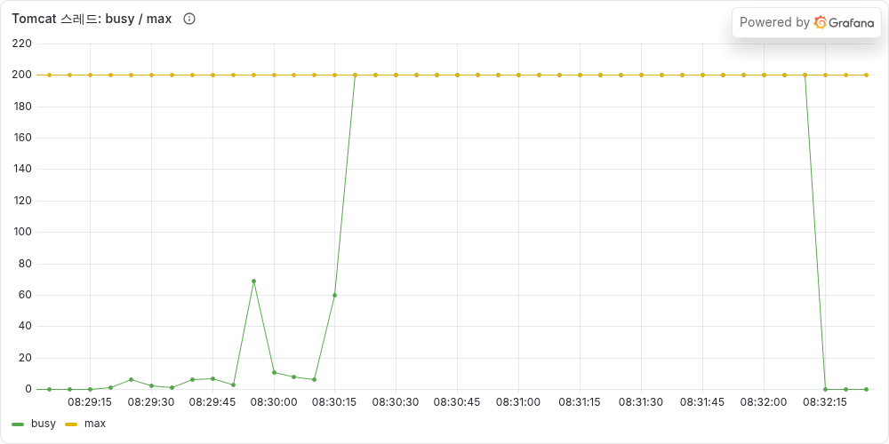
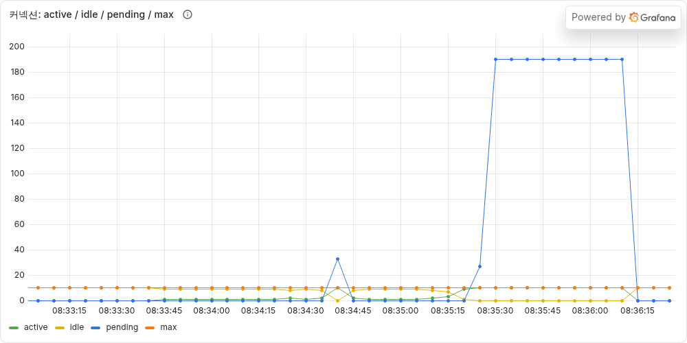
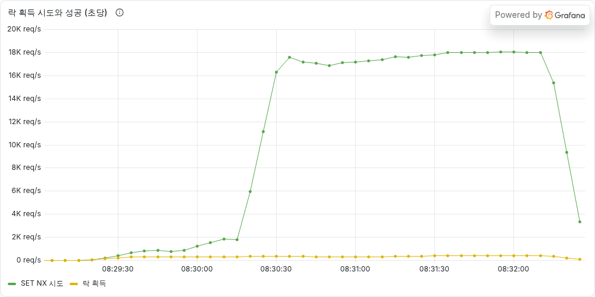
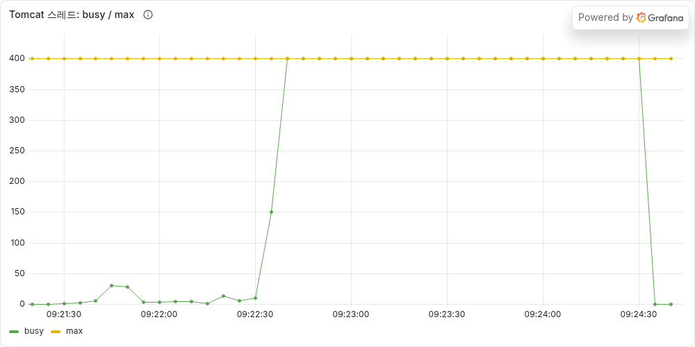

# [타임딜 #04] 분산 락을 걸었는데 300명이 샀다 — Redis 분산 락 vs 비관적 락

> **이번 글 요약**
> 1. Redis로 분산 락을 직접 만들어 붙였는데, 처음엔 **재고 100개에 최대 300명이 샀다.** 락을 **DB에 확정 저장(커밋)하기 전에** 풀고 있었다.
> 2. 커밋이 끝난 뒤에 락을 풀도록 고치자 정확히 100명만 샀다.
> 3. 그런데 주문이 몰리자 Redis 락은 비관적 락의 **절반**밖에 처리하지 못했고, 상관없는 상품 조회까지 **4.5초**로 느려졌다. 서버를 2대로 늘려도 같았다.
>
> | 방식 | 재고 100개에 300명 | 주문이 초당 600건 몰릴 때 처리량 | 그때 다른 상품 조회 응답 |
> |---|---|---|---|
> | Redis 락 (처음 버전) | **최대 300명 성공** ❌ | — | — |
> | Redis 락 (고친 버전) | 100명 성공 ✅ | **초당 약 310건** ❌ | **4.5초** ❌ |
> | 비관적 락 | 100명 성공 ✅ | 초당 600건 ✅ | 0.01초 ✅ |
> | 원자적 UPDATE | 100명 성공 ✅ | 초당 600건 ✅ | 0.01초 ✅ |

---

## 먼저 알아 둘 것: 은행으로 보는 서버

이번 글은 "누가 어디서 기다리느냐"가 핵심이라, 처음부터 끝까지 은행 하나로 비유하려고 한다.

| 서버 | 은행 | 이 프로젝트에서 |
|---|---|---|
| 요청 | 손님 | 주문, 상품 조회 |
| **Tomcat 스레드** | **직원** | 요청 하나를 맡아 끝까지 처리한다. 200명 |
| **DB 커넥션** | **창구** | 장부(DB)를 보려면 창구에 앉아야 한다. 10개 |
| 상품 재고 행 | 장부 한 페이지 | `product` 테이블의 2번 상품 행 |
| 락 | 장부 사용권 | 이 페이지는 한 번에 한 직원만 고친다 |
| 커밋 | 장부에 도장 찍기 | 도장을 찍어야 다른 직원 눈에도 바뀐 내용이 보인다 |

손님이 오면 직원이 한 명 붙고, 직원은 장부를 봐야 할 때 창구에 앉는다. **직원이 다 바쁘거나 창구가 다 차면, 다른 손님은 기다려야 한다.** 이 글의 숫자는 전부 이 두 줄 이야기다.

> **용어 두 개**
> - **p95**: 응답 100개를 빠른 순으로 세웠을 때 95번째. "대부분의 손님이 이 시간 안에 끝났다"는 뜻이다.
> - **TPS**: 서버가 1초에 **처리해 낸** 주문 수. K6가 1초에 **보낸** 수(RPS)보다 작으면 서버가 못 따라가고 있다는 뜻이다.

---

## Redis 분산 락을 써 본 이유

[지난 글(#03)](https://90000e.tistory.com/22)에서는 재고를 이런 SQL 한 줄로 줄이는 방식(원자적 UPDATE)을 골랐다.

```sql
UPDATE product SET stock = stock - 1 WHERE id = 2 AND stock >= 1
```

"재고가 1개 이상이면 1 빼 줘"를 DB가 한 번에 처리하니 락을 따로 걸 필요가 없었다. 그런데 정리하면서 걸리는 게 하나 있었다. **규칙이 이 WHERE 한 줄로 안 써지면 어떡하지?**

예를 들어 "한 사람당 하루 3개까지"라는 규칙이 붙으면, 재고 행만 봐서는 안 되고 주문 테이블에서 오늘 산 개수를 세 봐야 한다. 그러면 **읽고 → 확인하고 → 고치는** 여러 단계가 되고, 그 사이에 남이 끼어들지 못하게 락이 필요하다. #03에서 써 본 **비관적 락**(`SELECT ... FOR UPDATE`, 읽을 때부터 행을 잠그는 방식)이 그런 경우에 쓰는 방법이다.

그런데 비관적 락은 **창구에 앉은 채로** 장부 사용권을 기다린다. 창구는 10개뿐이라, 인기 상품 주문 10건이 장부 앞에 줄을 서면 창구가 다 찬다. 그러면 장부와 상관없는 손님(다른 상품 조회)도 창구에 앉지 못한다. #01에서 창구가 다 차서(커넥션 고갈) 크게 데였던 터라 이게 신경 쓰였다.

그래서 **Redis 분산 락**이 떠올랐다. 장부 사용권을 창구가 아니라 **로비(Redis)** 에서 받게 하면, 직원이 창구를 비워 둔 채 기다릴 수 있지 않을까 싶었다.

> **분산 락이란?**
> 자바의 `synchronized`는 **서버 한 대 안에서만** 통하는 락이다. 서버가 두 대면 각자 따로 잠그니 소용이 없다. 그래서 모든 서버가 같이 보는 곳(Redis)에 "2번 상품은 지금 내가 쓰는 중"이라고 적어 두는 방식이 **분산 락**이다.
>
> "분산"은 서버가 여러 대라는 뜻이 아니라 **락 표시를 서버 밖에 둔다**는 뜻이라, 서버 1대에서도 똑같이 동작한다. 생각해 보니 DB 락도 서버 밖(DB)에 있으니 원래 여러 서버에서 통하는 락이었다.
>
> | 락 | 서버 2대에서도 막아 주나 |
> |---|---|
> | `synchronized` | ❌ 서버마다 따로 잠근다 |
> | 비관적 락, 원자적 UPDATE | ✅ 모든 서버가 같은 DB 행을 본다 |
> | Redis 락 | ✅ 모든 서버가 같은 Redis 키를 본다 |
>
> 그래서 이번 글은 "서버 밖에 있는 락 두 종류(DB 락 vs Redis 락)"를 비교한다. 측정은 서버 1대로 먼저 하고, 마지막에 2대로도 확인했다.

---

## 직접 만든 Redis 락

Redisson 같은 라이브러리(분산 락을 만들어 둔 도구)도 있지만, 안에서 무슨 일이 일어나는지 보려고 Redis 명령어로 직접 만들었다.

**락 잡기**: Redis에 `lock:product:2`라는 키를 저장한다. 이 키가 있으면 "누가 쓰는 중"이라는 뜻이다.

```java
// 키가 없을 때만 저장하고(NX), 3초 뒤에는 저절로 지워지게(TTL) 한다
// token은 "내가 잡았다"는 증표로 쓰는 랜덤 문자열(UUID)
boolean locked = redisTemplate.opsForValue()
        .setIfAbsent("lock:product:2", token, Duration.ofSeconds(3));
```

- **키가 없을 때만 저장(NX)**: 여러 서버가 동시에 시도해도 Redis는 한 명만 성공시킨다. 나머지는 실패를 받는다.
- **3초 뒤 자동 삭제(TTL)**: 락을 잡은 서버가 갑자기 죽어도 3초 뒤엔 풀린다. 이게 없으면 그 상품은 영원히 잠긴다.
- 실패하면 10ms 쉬고 다시 시도하고, 5초 동안 못 잡으면 포기한다. 이렇게 될 때까지 계속 물어보는 방식을 **스핀 락**이라고 부른다.

**락 풀기**: 키를 지우면 되는데, 그냥 지우면 안 되는 경우가 있었다.

```lua
-- 키에 들어 있는 값이 내 token일 때만 지운다
if redis.call('get', KEYS[1]) == ARGV[1] then
    return redis.call('del', KEYS[1])
end
return 0
```

- 내 작업이 3초를 넘기면 락이 자동으로 풀리고, 그사이 다른 요청이 새로 락을 잡을 수 있다. 그때 내가 그냥 지우면 **남의 락을 지운다.** 그래서 "내 token일 때만" 지운다.
- "확인"과 "삭제"를 따로 보내면 그 사이에 키가 바뀔 수 있다. 위 코드는 **Lua 스크립트**라서 Redis가 중간에 다른 명령을 끼우지 않고 한 번에 실행한다.

---

## 락은 정상인데 300명이 산 이유

### 처음 버전

락이 필요한 상황(규칙이 복잡해서 읽고 → 확인하고 → 고쳐야 하는 경우)을 흉내 내려고, 재고 계산을 #03 이전처럼 **자바 코드에서** 하도록 되돌렸다. 그리고 그 계산을 Redis 락으로 감쌌다.

```java
@Transactional   // OrderService가 연 트랜잭션에 참여한다
public Product decreaseStock(Long productId, int quantity) {
    return redisLock.executeWithLock("lock:product:" + productId, () -> {
        Product product = getProduct(productId);   // 재고 읽기
        product.decreaseStock(quantity);           // 자바에서 재고 - 1
        return product;
    });   // ← 여기서 락을 푼다
}
// 이 메서드가 끝나면 OrderService가 같은 트랜잭션 안에서 주문을 저장하고, 그다음 커밋한다
```

깔끔해 보였다. 그런데 동시성 테스트(재고 50개에 100명이 동시에 주문)부터 깨졌다.

```text
OrderConcurrencyTest > 동시에_주문해도_재고보다_많이_팔리지_않는다()  FAILED
    [주문 성공] expected: 50  but was: 100
```

K6로 #03과 같은 **타임딜 오픈 테스트**(재고 100개 상품에 300명이 동시에 1번씩 주문)도 돌려 봤다.

| 회차 | 주문 성공 | 품절 응답 | 남은 재고 |
|---|---|---|---|
| 1회 | **248** | 52 | 0 |
| 2회 | **299** | 1 | 0 |
| 3회 | **300** | 0 | **23** |

100개짜리 재고에서 248~300개가 팔렸다. 3회차는 300개를 팔고도 재고가 23개 남았다고 나온다. 락이 없던 #03(300명 성공, 재고 65개 남음)과 거의 다를 게 없었다.

더 이상한 건 락 지표였다. 세 번 돌리는 동안 **락은 900번(회차당 300번) 정상으로 잡히고 풀렸다.** 락이 고장 난 게 아니었다.

### 실제로 일이 일어나는 순서

코드에 적힌 순서 말고, 실제로 DB에 일이 일어나는 순서를 적어 보니 보였다.

```text
[트랜잭션 시작: 창구에 앉음]
  → Redis 락 획득
  → SELECT stock          → 100을 읽음
  → 자바에서 stock = 99    ← 자바 객체 값만 바뀜. DB에는 아직 아무것도 안 감
  → Redis 락 해제          ← 여기서 다음 요청이 락을 잡고 들어온다
  → INSERT orders
[커밋]                     ← 이때 비로소 UPDATE product SET stock = 99 가 나감
```

JPA는 객체 값을 바꿔도 바로 UPDATE를 보내지 않고, **커밋할 때 모아서** 보낸다(이걸 더티 체킹이라고 한다). 그래서 락을 푸는 순간 DB의 재고는 아직 100이다. 다음 요청은 락을 잡고 들어와서 **여전히 100을 읽고**, 똑같이 99로 고친다. 락이 지켜 준 건 SELECT 한 줄뿐이었다.

은행으로 말하면 장부를 고친 뒤 **도장도 찍기 전에 사용권부터 반납한 것**이다. 다음 직원은 아직 안 고쳐진 장부를 받는다.

순서를 보다가 하나 더 보였다. 트랜잭션이 먼저 시작되고 그 안에서 락을 기다리니, **창구에 앉은 채로 사용권을 기다리고 있었다.** 원래 하려던 "창구를 비워 두고 기다리기"도 못 하고 있었던 셈이다.

### saveAndFlush로 고치려다 실패

처음엔 "UPDATE가 늦게 나가는 게 문제면, 락 안에서 바로 보내면 되지 않나?" 싶었다. `saveAndFlush`는 UPDATE를 그 자리에서 DB로 보내는 메서드다. 흔히 보이는 수정이라 직접 해 봤다.

```java
product.decreaseStock(quantity);
productRepository.saveAndFlush(product);   // UPDATE를 락 안에서 바로 보낸다
```

| | 동시성 테스트 (재고 50, 100명) | 타임딜 오픈 테스트 (재고 100, 300명) |
|---|---|---|
| saveAndFlush 추가 | 96명 성공 ❌ | 197개, 179개 판매 ❌ |

줄기만 하고 고쳐지지 않았다. UPDATE는 락 안에서 나갔지만, **도장(커밋)은 여전히 락을 푼 뒤에** 찍혔기 때문이다.

1. 다음 요청이 락을 잡고 재고를 읽는다. 앞 요청이 아직 커밋 전이라 **예전 값 100**이 보인다. (MySQL은 커밋 안 된 변경을 남에게 보여 주지 않는다. #03에서 본 내용이다.)
2. 다음 요청도 99로 고치려고 UPDATE를 보낸다. 앞 요청이 그 행을 고치는 중이라 잠깐 기다린다.
3. 앞 요청이 커밋하면, 기다리던 UPDATE가 **예전 값으로 계산한 99**를 그대로 덮어쓴다.

> **정리**: 락을 커밋보다 먼저 풀면, 다음 사람은 아직 확정되지 않은 데이터를 받는다. 락이 동작하는 것과 락이 맞는 범위를 지키는 것은 다른 문제였다.

---

## 해결: 락 획득 → 트랜잭션 → 커밋 → 락 해제

락이 트랜잭션 전체를 바깥에서 감싸도록 순서를 바꿨다. 이러면 커밋이 끝난 뒤에 락이 풀린다.

```java
String lockKey = ProductService.stockLockKey(productId);
Order order = redisLock.executeWithLock(lockKey, () ->     // 1. 락을 먼저 잡고
        transactionTemplate.execute(status -> {             // 2. 그 안에서 트랜잭션을 연다
            Product product = productService.decreaseStock(productId, quantity);
            return orderRepository.save(Order.create(userId, productId, quantity, product.getPrice()));
        }));                                                // 3. 커밋이 끝나야 락을 푼다
```

`transactionTemplate`은 트랜잭션 범위를 코드로 직접 정하는 도구다. #02에서 결제 호출을 트랜잭션 밖으로 빼면서 쓰기 시작했다.

이렇게 하면 덤도 생긴다. 락을 **트랜잭션 밖에서** 기다리니, 이제야 **창구를 비워 둔 채 로비에서** 기다리게 된다. 결제가 실패해서 재고를 되돌리는 코드도 같은 락으로 감쌌다. 차감만 지키고 복구를 안 지키면 복구에서 같은 문제가 생긴다(#03에서 배운 것).

다른 방법도 생각해 봤다.
- **트랜잭션이 끝난 뒤 실행되는 콜백에서 락 풀기**: 커밋 뒤에 풀리긴 한다. 하지만 락을 여전히 트랜잭션 안에서 잡으니, 창구에 앉은 채 기다리는 건 그대로라 고르지 않았다.
- **Redisson으로 바꾸기**: 락 자체는 더 좋아지지만, "어디서 푸느냐"는 내가 정하는 거라 같은 버그가 난다.

```text
OrderConcurrencyTest > 동시에_주문해도_재고보다_많이_팔리지_않는다()  PASSED
```

| 방식 (재고 100, 300명, 3회씩) | 성공 / 품절 | 남은 재고 | p95 |
|---|---|---|---|
| Redis 락 (고친 버전) | 100 / 200 | 0 ✅ | 0.87~1.75초 |
| 비관적 락 | 100 / 200 | 0 ✅ | 0.52~0.68초 |
| 원자적 UPDATE | 100 / 200 | 0 ✅ | 0.45~0.71초 |

재고는 세 방식 모두 맞았다. 다만 Redis 락만 확실히 느렸다. 왜 느린지는 아래 부하 테스트에서 드러났다.

(Redis가 같은 맥북의 CPU를 나눠 쓰게 돼서, 비관적 락과 원자적 UPDATE도 이번 환경에서 다시 쟀다.)

---

## 인기 상품 주문과 다른 상품 조회를 함께 보낸 결과

이제 이 글을 시작한 이유를 확인할 차례다. 인기 상품 주문만 보내면 "창구를 비워 둔다"는 차이가 안 보인다. 그래서 테스트를 새로 만들었다.

- 인기 상품(2번) 주문을 초당 300 → 600 → 900건으로 올린다
- 그동안 **상관없는 상품 조회**(`GET /api/products/1`)를 초당 50건 함께 보낸다
- 가짜 결제 대기 시간은 0으로 둔다. 결제 대기 0.3초가 있으면 락 차이가 그 뒤에 묻혀서 안 보인다

내 예상은 이랬다. **비관적 락은 직원들이 창구를 다 차지해서 조회 손님도 못 앉고, Redis 락은 창구가 비어 있으니 조회가 멀쩡할 것이다.**

| 방식 | 보낸 주문 | 처리한 주문 (TPS) | 바쁜 직원 (최대 200) | 창구 대기 | 조회 p95 |
|---|---|---|---|---|---|
| Redis 락 | 300 | 300 | 69 | 0 | 0.01초 |
| | **600** | **약 310** | **200 (전원)** | **0** | **4.5초** |
| | 900 | 약 400 | 200 | 0 | 4.5초 |
| 비관적 락 | 300 | 300 | 1 | 0 | 0.01초 |
| | 600 | 600 | 43 | 33 | 0.01초 |
| | 900 | 약 840 | 200 | 190 | 1.7초 |
| 원자적 UPDATE | 300 | 300 | 3 | 0 | 0.01초 |
| | 600 | 600 | 33 | 24 | 0.01초 |
| | 900 | 약 760 | 200 | 190 | 1.8초 |

(두 번 돌렸고 모양은 같았다. 위 표는 2회차다. "창구 대기"는 창구가 비기를 기다리는 요청 수다.)

**예상은 절반만 맞았다.**
- **맞은 것**: Redis 락은 정말로 창구를 차지하지 않았다. 창구 대기는 끝까지 0이었고, 동시에 쓴 창구도 최대 3개였다.
- **틀린 것**: 그런데도 **조회가 가장 먼저, 가장 크게 느려졌다.** 초당 600건에서 비관적 락은 조회가 0.01초였는데, Redis 락은 4.5초였다.

### 줄이 창구에서 직원으로 이동

바쁜 직원 수(Tomcat 스레드) 그래프를 보고 이해가 됐다.



Redis 락은 주문을 초당 약 310건밖에 처리하지 못했다. 처리하지 못한 주문들은 **직원을 한 명씩 붙잡은 채** 로비에서 사용권을 기다렸다. 직원 200명이 전부 로비에서 기다리게 되자, 새로 온 조회 손님은 창구가 아니라 **직원을 배정받지 못해서** 기다렸다.



비관적 락은 초당 600건까지는 창구 대기(파란 선)가 잠깐 튀는 정도였고, 900건에서야 창구 대기가 190까지 찼다.

결국 **줄 서는 장소만 창구에서 로비로 바뀌었다.** 창구든 직원이든 모든 손님이 같이 쓰는 자원이라, 한쪽이 꽉 차면 상관없는 손님도 같이 막힌다.

### Redis 락이 초당 300건에서 멈춘 이유

비관적 락은 초당 600건을 처리했는데 Redis 락은 왜 절반이었을까.

락은 한 번에 한 명만 쥘 수 있으니, **1초에 처리할 수 있는 주문 수 = 1초 ÷ 한 명이 락을 쥐고 있는 시간**이다. 그래서 락을 쥐고 있는 동안 무엇을 하는지 비교해 봤다.

```text
Redis 락: 사용권을 받은 다음에 준비를 시작한다
  [사용권 쥠] Redis에 락 요청 → 창구에 앉음 → 트랜잭션 시작 → 읽기, 주문 저장, 재고 수정 → 커밋
             → 창구에서 일어남 → Redis에 락 해제 요청 [사용권 반납]

비관적 락: 준비는 미리 끝내 두고 문 앞에서 기다린다
  (10명이 동시에) 창구에 앉음 → 트랜잭션 시작 → 장부 앞에서 대기
  [사용권 쥠] 읽기, 주문 저장, 재고 수정 → 커밋 [사용권 반납] → 바로 다음 사람
```

- Redis 락에서 창구에 앉아 있던 시간(DB 작업)은 주문당 약 1.7ms였다.
- 그런데 초당 300건을 처리했다는 건, 1000ms ÷ 300 ≈ **한 명이 락을 약 3.3ms 쥐고 있었다**는 뜻이다.
- 차이 약 1.6ms는 **Redis를 오가는 시간, 창구에 앉고 트랜잭션을 여는 준비 시간**이다. 이 시간에도 사용권을 쥐고 있으니 아무도 재고를 못 만진다.
- 비관적 락은 다음 사람이 이미 창구에 앉아 장부를 펴 둔 채 기다린다. 앞사람이 도장을 찍으면 MySQL이 바로 다음 사람에게 넘겨준다.

창구를 쥐고 기다리는 게 비관적 락의 단점인 줄만 알았는데, **바로 이어받는 속도에서는 오히려 장점**이었다.

스핀 대기에도 비용이 있었다. 기다리는 직원 200명이 10ms마다 "락 비었어?"를 물어서, Redis에 **초당 약 1만 8천 번** 요청이 갔다. 실제로 락을 얻은 건 초당 300~400번뿐이다.



---

## 서버 2대로 다시 측정

"분산 락이면 서버를 2대 띄워 봐야 하는 거 아닌가?" 싶었다. 그래서 같은 앱을 2대 띄우고(8080, 8082 포트), K6가 두 서버에 번갈아 요청을 보내게 했다. 서버마다 직원 200명, 창구 10개라 합치면 직원 400명, 창구 20개다.

먼저 정합성이다. 두 서버가 같은 재고를 동시에 깎는다.

| 방식 (서버 2대, 재고 100, 300명, 2회씩) | 성공 / 품절 | 남은 재고 |
|---|---|---|
| Redis 락 | 100 / 200 | 0 ✅ |
| 비관적 락 | 100 / 200 | 0 ✅ |
| 원자적 UPDATE | 100 / 200 | 0 ✅ |

셋 다 맞았다. 셋 다 서버 밖(Redis, DB)에서 줄을 세우기 때문이다.

다음은 Redis 락의 처리량을 서버 1대와 2대로 비교했다(주문 초당 600건 구간).

| Redis 락 | 서버 1대 | 서버 2대 |
|---|---|---|
| 처리한 주문 (TPS) | 약 310 | **약 260** |
| 조회 p95 | 4.5초 | 5.1초 |
| Redis에 "락 비었어?" 요청 | 초당 약 1만 8천 번 | **초당 약 3만 4천 번** |
| 5초 안에 락을 못 잡아 실패한 주문 (전체) | 17~66건 | **1,381건** |



서버를 늘려도 **처리량은 늘지 않았다.** 재고 키(`lock:product:2`)는 서버가 몇 대든 하나뿐이라, 한 명이 3.3ms씩 쥐는 줄의 속도는 그대로다. 늘어난 건 줄 서는 직원(400명 전원)과, 그 직원들이 Redis에 묻는 횟수와, 기다리다 포기한 주문뿐이었다.

같은 구간에서 비관적 락과 원자적 UPDATE는 서버 2대에서도 초당 600건을 처리했다. 900건 구간에서 둘 중 누가 나은지는 측정할 때마다 순서가 바뀌어서, 내 맥북의 한계 구간 노이즈로 보고 결론을 내지 않았다.

---

## 최종 선택: 재고 차감은 원자적 UPDATE 유지

락을 커밋보다 먼저 푸는 버그는 고쳤다. 하지만 **이 프로젝트의 재고 차감에는 Redis 락을 쓰지 않기로 했다.** 지금 재고 규칙은 WHERE 한 줄로 되고, 그럴 때는 원자적 UPDATE가 처리량, 다른 요청의 응답 속도, 코드 단순함 모두에서 나았다.

그럼 분산 락은 언제 쓰는 걸까. 찾아보고 오늘 결과를 겹쳐 보니 이렇게 정리됐다.
- **지키려는 게 DB 행 하나가 아닐 때**: 외부 API 호출, 여러 저장소에 걸친 작업, 여러 서버에서 같은 스케줄러가 동시에 도는 것 막기. 이런 건 DB 락으로 막을 수 없다.
- **기다리지 않고 바로 실패시킬 때**: 락을 못 잡으면 바로 "잠시 후 다시 시도해 주세요"를 돌려주면, 직원이 로비에 쌓이지 않는다.
- **꼭 기다려야 한다면**: 10ms마다 묻는 대신 락이 풀릴 때 Redis가 알려 주는 방식(Redisson이 이렇게 동작한다)을 써야 초당 1만 8천 번씩 묻지 않는다.

> **정리**: 분산 락은 어디서 푸느냐를 잘못 잡으면 재고가 틀어지고, 제대로 잡아도 한 상품에 주문이 몰리면 DB 락보다 느렸다. "창구를 비워 두고 기다린다"는 장점은 진짜였지만, 기다리는 동안 직원을 붙잡고 있으니 줄 서는 장소만 바뀌었다.

---

## 남은 과제

이번 테스트에서 하나 더 보였다. 재고가 다 팔린 뒤에도 "품절"이라는 답을 들을 요청들이 **전부** 줄을 서거나 DB까지 간다. 재고 100개에 10만 명이 몰리면 99,900명이 "품절" 한 마디를 듣기 위해 줄을 선다.

줄 서는 장소를 옮기는 게 아니라 **줄 자체를 없앨 수는 없을까.** 다음 글에서는 재고 숫자 자체를 Redis에 두고(DECR, Lua), 품절 요청은 DB에 닿기 전에 돌려보내 볼 생각이다.

---

- 코드: https://github.com/gamgam330/timedeal-order-system
- 이번 글의 변경: https://github.com/gamgam330/timedeal-order-system/compare/step-03-broken...step-03-fixed
